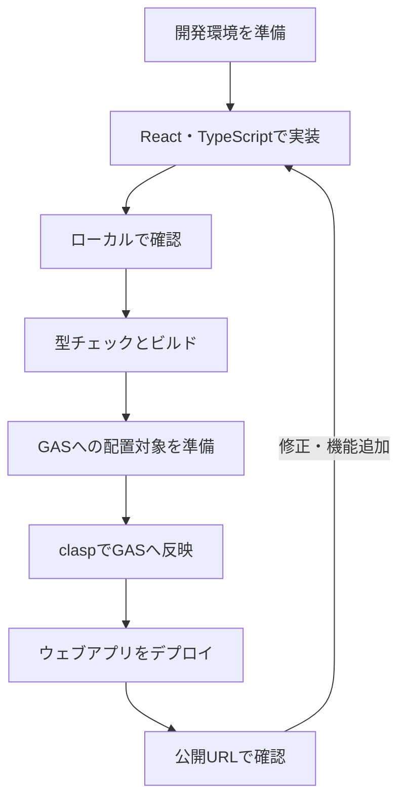

# React・TypeScriptで作るGASアプリケーション

React・TypeScriptを使用して画面を開発し，Google Apps Script（GAS）のウェブアプリとして公開するための開発ガイドです。

macOS・zshを開発環境とし，環境構築，プロジェクトの作成，ローカルでの動作確認，ビルド，GASへのデプロイまでを順に説明します。

応用編では，Tailwind CSS，React RouterのHash方式，Googleサービスとの連携，GASの制約，アーキテクチャを扱います。

初めて読む方は，[001. 全体像](docs/basics/001-overview.md)から読み進めてください。

## このガイドで扱うこと

- React・TypeScript・Viteによるプロジェクトの作成
- ローカル環境での画面確認とデバッグ
- vite-plugin-singlefileによる配信用HTMLの生成
- claspによるGASプロジェクトへの反映
- ウェブアプリの公開と既存デプロイの更新
- Tailwind CSSによるスタイリング
- コンポーネントと状態管理の整理
- React RouterのHash方式による画面遷移
- GAS経由でのGoogleスプレッドシートの読み取り
- 実行権限，割り当て，同時更新などの注意点
- 保守しやすい責務分離と構成の検討

## 対象読者

- GASのコードをローカル環境で管理したい方
- Reactを使ってGASの画面を作りたい方
- TypeScriptを使用した開発を取り入れたい方
- Googleサービスと連携する業務アプリを作りたい方
- Gitによる変更管理と，公開・更新の手順を整理したい方

HTML・CSS・JavaScriptの基本的な知識を前提とします。

React・TypeScriptは，サンプルで使用する範囲を説明します。各言語やライブラリの機能を網羅するガイドではありません。

## 使用する技術

| 技術                   | 役割                                    |
|------------------------|-----------------------------------------|
| React                  | コンポーネントによる画面の構築          |
| TypeScript             | フロントエンドの型定義と実装            |
| Vite                   | 開発用サーバーと本番用ビルド            |
| Tailwind CSS           | 画面のスタイリング                      |
| vite-plugin-singlefile | JavaScript・CSSのHTMLへの集約           |
| React Router           | Hash方式によるSPAの画面遷移             |
| Google Apps Script     | HTMLの配信とサーバー側の処理            |
| clasp                  | ローカルファイルとGASプロジェクトの連携 |
| Git                    | コードとドキュメントの変更管理          |

本ガイドの応用編では，Tailwind CSS v4系，React Router v7系を指定した手順を掲載しています。

それ以外のツールを含め，導入時には各章の手順と公式の動作要件を確認してください。

## 開発から公開までの流れ



基本編は最小のカウンター画面から始め，応用編でスタイリング，部品分割，複数画面，一覧取得へ発展させます。

## 目次

### 基本編

環境構築からGASへの公開・更新までを順番に進めます。

| 章                                                                | 内容                                                           |
|-------------------------------------------------------------------|----------------------------------------------------------------|
| [001. 全体像](docs/basics/001-overview.md)                        | 目的，使用技術，実行環境，開発から公開までの流れ               |
| [002. 開発環境の準備](docs/basics/002-setup.md)                   | macOS・zsh，エディタ，Git，Node.js，npm，clasp，Google認証     |
| [003. プロジェクトの作成](docs/basics/003-create-project.md)      | React・TypeScriptの初期化，最小画面，ビルド設定，GAS側のコード |
| [004. ローカルでの実行とデバッグ](docs/basics/004-local-debug.md) | 開発用サーバー，開発者ツール，型チェック，ビルド結果の確認     |
| [005. GASへのデプロイ](docs/basics/005-deploy.md)                 | 配置準備，claspでの反映，初回公開，既存URLを維持した更新       |

### 応用編

基本編で作成したアプリケーションを段階的に拡張し，設計・運用の注意点を確認します。

| 章                                                                                     | 内容                                                           |
|----------------------------------------------------------------------------------------|----------------------------------------------------------------|
| [101. Tailwind CSSによるスタイリング](docs/advanced/101-tailwindcss.md)                | Viteプラグインの導入，スタイルの置き換え，レスポンシブ対応     |
| [102. React・TypeScriptによるフロントエンド開発](docs/advanced/102-modern-frontend.md) | 共通部品，Props，カスタムフック，状態の配置                    |
| [103. SPAと画面遷移](docs/advanced/103-spa-application.md)                             | HashRouter，共通レイアウト，ルート定義，状態保持               |
| [104. Googleサービスとの連携](docs/advanced/104-use-google-services.md)                | スプレッドシートの読み取り，非同期通信，レスポンス検証，モック |
| [105. GASの制約と注意点](docs/advanced/105-disadvantage-of-gas.md)                     | 割り当て，iframe，権限，同時更新，運用と採用判断               |
| [106. GASアプリケーションのアーキテクチャ](docs/advanced/106-gas-architecture.md)      | 責務分離，API境界，データアクセス，設定，テスト，環境分離      |

## 読み進め方

### 初めて取り組む場合

基本編を001から005まで進めた後，応用編を101から104まで順に実装します。

105と106では，作成したアプリケーションを題材に，制約と設計を検討します。追加実装が必須の章ではありません。

### 必要な内容を調べる場合

目次から該当する章へ進んでください。

ただし，コード例は前の章の実装を前提にしている場合があります。途中の章から読む場合は，各章の前提条件も確認してください。

### 業務利用を検討している場合

実装手順に加え，次を確認してください。

- [105. GASの制約と注意点](docs/advanced/105-disadvantage-of-gas.md)
- [106. GASアプリケーションのアーキテクチャ](docs/advanced/106-gas-architecture.md)

機能が動くことと，安全に運用できることは分けて確認します。

## リポジトリの構成

```text
.
├── README.md
├── docs/
│   ├── basics/
│   │   ├── 001-overview.md
│   │   ├── 002-setup.md
│   │   ├── 003-create-project.md
│   │   ├── 004-local-debug.md
│   │   └── 005-deploy.md
│   └── advanced/
│       ├── 101-tailwindcss.md
│       ├── 102-modern-frontend.md
│       ├── 103-spa-application.md
│       ├── 104-use-google-services.md
│       ├── 105-disadvantage-of-gas.md
│       └── 106-gas-architecture.md
└── gemini-scripts/
    └── ドキュメント作成用のzshスクリプト
```

### ドキュメントとアプリケーションの区別

このリポジトリは，開発手順をまとめるためのものです。

本文の手順で作成するアプリケーションは，別ディレクトリで管理する構成にしています。

```text
~/git/
├── gas-react-guide/   # このガイドのリポジトリ名の例
└── gas-react-app/     # 手順に沿って作成するアプリ
```

ディレクトリ名は例です。実際の保存場所に合わせて読み替えてください。

`gemini-scripts/` 内のスクリプトは，手順書を作成するためのものです。アプリケーションのセットアップやデプロイを自動実行するスクリプトではありません。

## コード例とスクリプトの扱い

- コマンドは，記載された作業ディレクトリで実行してください。
- プレースホルダーは，自分の環境の値へ置き換えてください。
- ファイルの新規作成・追記・全体置き換えを区別してください。
- スクリプトの内容を確認してから実行してください。
- zsh用スクリプトは，`zsh` または実行権限を付けた直接実行で使用してください。
- Git操作の前に，追加対象と差分を確認してください。

ドキュメント作成用スクリプトには，末尾に次の操作を含めています。

```sh
git add .
git commit -m '変更内容を表す日本語メッセージ'
```

初期作成用スクリプトは，既存の対象ファイルを上書きしません。作成済みのドキュメントを修正する場合は，通常の編集作業または別の更新用スクリプトで行います。

## 注意事項

### 公開範囲と権限

最初の動作確認は，自分だけがアクセスできる範囲で行ってください。

学習用サンプルには，複数利用者向けの認可や，業務用のすべての安全対策を含めているわけではありません。

### データと認証情報

学習にはダミーデータを使用し，個人情報や機密情報を持ち込まないでください。

認証ファイル，トークン，秘密情報をGitHubへ公開しないでください。ブラウザへ配信するコードにも秘密情報を埋め込まないでください。

### ローカル環境とGAS

ローカルでの表示やモックの成功だけでは，GAS上の権限やGoogleサービスとの連携は確認できません。

GAS上で，実際の公開設定と実行権限を含めて確認してください。

### SPAのURL

GASのHTMLサービスでは，アプリケーションがiframe内で動作します。

HashRouterによる内部画面の遷移と，外側の公開URLの共有・同期は別の設計として扱います。

### バージョンと割り当て

ツールのコマンド，設定方法，GASの割り当ては変更される場合があります。

本文の情報に加え，使用時点の公式資料も確認してください。

## 動作確認について

このREADMEの生成は，掲載手順を実環境で検証したことを意味しません。

動作確認情報を公開する際は，実際に確認した結果に基づいて，次を記載する方針です。

- 確認日
- 対象の章とコミット
- macOSとCPUアーキテクチャ
- Node.js・npm・claspのバージョン
- 主要な依存パッケージのバージョン
- 使用したブラウザ
- 確認できた範囲と未確認の範囲

## 誤記・改善提案

誤記，手順の不整合，改善案がある場合は，このリポジトリのIssueまたはPull Requestで共有してください。

報告には，次の情報を含めると確認しやすくなります。

- 対象の章と見出し
- 実行したコマンド
- 期待した結果
- 実際の結果とエラーメッセージ
- 使用環境と各ツールのバージョン

認証情報，個人情報，実データが含まれていないことを確認してから投稿してください。

## ライセンス

本文とコード例の利用条件は，リポジトリに明示するライセンスに従ってください。

ライセンスがまだ明示されていない場合，公開リポジトリであることだけをもって，再配布や改変の許諾があるとは解釈しないでください。

利用している各ライブラリや外部資料には，それぞれのライセンスと利用条件が適用されます。
