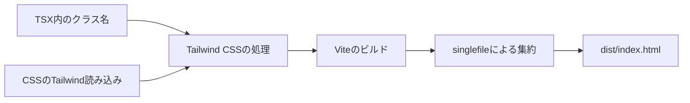
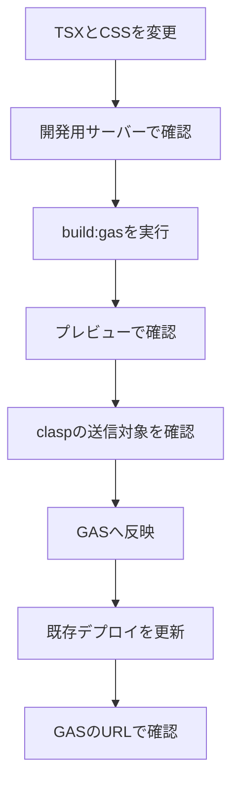

# 101. Tailwind CSSによるスタイリング

## この章の目的

基本編で作成した画面を，Tailwind CSSを使用した実装へ置き換えます。

この章では，次の内容を扱います。

- Tailwind CSSの導入
- Viteプラグインの設定
- 既存CSSからの置き換え
- レスポンシブ対応と操作状態のスタイリング
- クラス名の検出に関する注意
- ビルドとGAS上での確認

Reactの状態管理とGAS側の処理は，大きく変更しません。

## 1. 前提条件

基本編を完了し，次の状態になっていることを前提にします。

- React・TypeScriptのアプリケーションが動作する。
- vite-plugin-singlefileを設定している。
- `npm run build:gas` で配置対象を生成できる。
- claspでGASへ反映できる。
- ウェブアプリの公開URLで画面を確認できる。

コマンドは，アプリケーションのルートで実行します。

```sh
cd ~/git/gas-react-app
```

### 1.1 使用する方式

本章では，Tailwind CSS v4系と `@tailwindcss/vite` を使用します。

次のようなv3系向けの手順は，本章では使用しません。

```text
npx tailwindcss init -p
@tailwind base;
@tailwind components;
@tailwind utilities;
```

最小構成では，`tailwind.config.js` やTailwind用のPostCSS設定ファイルも新規作成しません。

別のプロジェクトから設定を持ち込む場合は，使用しているメジャーバージョンと導入方式を確認してください。

## 2. Tailwind CSSの役割

Tailwind CSSでは，見た目を指定する小さなクラスを組み合わせて画面を作ります。

たとえば，次のように記述します。

```tsx
<h1 className="text-2xl font-bold text-slate-900">
  Reactで作るGASアプリ
</h1>
```

| クラス | 指定する内容 |
|---|---|
| `text-2xl` | 文字サイズ |
| `font-bold` | 文字の太さ |
| `text-slate-900` | 文字色 |

Tailwind CSSは，ソースに記述されたクラスを検出し，必要なCSSをビルド時に生成します。

ブラウザやGAS上でTailwindのビルド処理を実行する構成ではありません。



## 3. 作業前の状態を確認する

```sh
git status --short
```

未コミットの変更がある場合は，内容を確認し，今回の作業と分けて整理します。

必要であれば，作業用ブランチを作成します。

```sh
git switch -c feature/tailwindcss
```

ブランチ名は例です。同名のブランチが既にある場合は，別名にするか既存ブランチを確認してください。

## 4. パッケージをインストールする

```sh
npm install --save-dev tailwindcss@4 @tailwindcss/vite@4
```

本章では，両方をビルド用の依存パッケージとして追加します。

導入結果を確認します。

```sh
npm ls tailwindcss @tailwindcss/vite
```

両パッケージがv4系であり，依存関係のエラーがないことを確認します。

具体的な解決バージョンは `package-lock.json` に記録されます。このファイルもGitで管理します。

## 5. Viteの設定を変更する

`vite.config.ts` の内容全体を，次のコードへ置き換えます。

```ts
import { defineConfig } from "vite";
import react from "@vitejs/plugin-react";
import tailwindcss from "@tailwindcss/vite";
import { viteSingleFile } from "vite-plugin-singlefile";

export default defineConfig({
  plugins: [
    react(),
    tailwindcss(),
    viteSingleFile(),
  ],
  base: "./",
  publicDir: false,
});
```

基本編で設定した `viteSingleFile()`，`base`，`publicDir` は維持します。

既に独自の設定を追加している場合は，その内容を確認し，必要な設定を失わないように統合してください。

開発用サーバーを起動中の場合は，設定変更後に停止・再起動します。

## 6. CSSを置き換える

`src/index.css` の内容全体を，次のコードへ置き換えます。

```css
@import "tailwindcss";

:root {
  font-family:
    system-ui, -apple-system, BlinkMacSystemFont, "Segoe UI",
    sans-serif;
  font-synthesis: none;
  text-rendering: optimizeLegibility;
}

body {
  margin: 0;
  min-width: 320px;
}
```

`@import "tailwindcss";` は先頭に記述します。

基本編で使用した `.app`，`.card`，`button` などの独自スタイルは，この置き換えで削除します。残したままだと，Tailwindのクラスと競合する場合があります。

`src/main.tsx` の次の読み込みは維持します。

```tsx
import "./index.css";
```

### 6.1 ベーススタイルの変化

Tailwind CSSには，ブラウザの既定スタイルを整えるPreflightが含まれます。

見出しやボタンなどは，HTML要素を置くだけでは以前と同じ見た目にならない場合があります。文字サイズ，余白，背景色などを必要に応じて指定します。

## 7. 画面をTailwind CSSへ置き換える

`src/App.tsx` の内容全体を，次のコードへ置き換えます。

```tsx
import { useState } from "react";

export default function App() {
  const [count, setCount] = useState(0);

  return (
    <main className="grid min-h-screen place-items-center bg-slate-100 p-4 text-slate-900 sm:p-8">
      <section
        aria-labelledby="app-title"
        className="w-full max-w-2xl rounded-2xl border border-slate-200 bg-white p-6 shadow-sm sm:p-10"
      >
        <p className="mb-2 text-sm font-medium text-slate-600">
          Google Apps Script
        </p>

        <h1
          id="app-title"
          className="text-2xl font-bold tracking-tight sm:text-3xl"
        >
          Reactで作るGASアプリ
        </h1>

        <p className="mt-4 leading-8 text-slate-700">
          Tailwind CSSで画面を整えました。
          ボタンを押して動作を確認してください。
        </p>

        <div className="mt-6 flex flex-col gap-3 sm:flex-row">
          <button
            type="button"
            onClick={() => {
              setCount((previous) => previous + 1);
            }}
            className="inline-flex min-h-11 items-center justify-center rounded-lg bg-blue-700 px-5 py-3 font-medium text-white transition-colors hover:bg-blue-800 focus-visible:outline-2 focus-visible:outline-offset-4 focus-visible:outline-blue-700"
          >
            カウントを増やす
          </button>

          <button
            type="button"
            onClick={() => {
              setCount(0);
            }}
            disabled={count === 0}
            className="inline-flex min-h-11 items-center justify-center rounded-lg border border-slate-300 bg-white px-5 py-3 font-medium text-slate-800 transition-colors enabled:hover:bg-slate-100 focus-visible:outline-2 focus-visible:outline-offset-4 focus-visible:outline-blue-700 disabled:cursor-not-allowed disabled:opacity-50"
          >
            リセット
          </button>
        </div>

        <p
          role="status"
          aria-live="polite"
          aria-atomic="true"
          className="mt-6 rounded-lg bg-slate-100 px-4 py-3 text-lg font-semibold"
        >
          現在のカウント：{count}
        </p>
      </section>
    </main>
  );
}
```

元のカウンター機能に，リセットボタンを追加しています。

この章でもカウントはブラウザ内の状態です。GASやGoogleサービスへ保存する処理は追加していません。

## 8. クラスの役割を確認する

### 8.1 レイアウトと余白

| クラス | 役割 |
|---|---|
| `grid place-items-center` | 子要素を中央へ配置する |
| `min-h-screen` | 画面の高さを基準に最小高さを指定する |
| `w-full max-w-2xl` | 幅を確保しつつ最大幅を制限する |
| `p-6` | 内側の余白を指定する |
| `mt-6` | 上側の外余白を指定する |
| `gap-3` | 子要素間の間隔を指定する |

### 8.2 レスポンシブ対応

次の指定を例に考えます。

```tsx
<div className="flex flex-col gap-3 sm:flex-row">
```

通常は `flex-col` で縦に並べ，`sm` のブレークポイント以上で `flex-row` に切り替えます。

`sm:` は「スマートフォンだけに適用する」という意味ではありません。指定されたブレークポイント以上に適用する接頭辞です。

GASのHTMLサービス上では，実際に画面を表示しているiframeの表示領域も考慮して確認します。

### 8.3 操作状態

| 接頭辞 | 対象となる状態 |
|---|---|
| `hover:` | ポインターを重ねた状態 |
| `focus-visible:` | キーボード操作などでフォーカス表示が必要な状態 |
| `disabled:` | 無効な状態 |
| `enabled:hover:` | 有効であり，ポインターを重ねた状態 |

色の変化だけに依存せず，ボタンの文言や無効状態も合わせて確認します。

## 9. クラス名を動的に組み立てない

Tailwind CSSはソースを文字列として走査するため，クラス名の一部だけを組み立てる書き方は避けます。

避ける例：

```tsx
const color = "blue";
const className = `bg-${color}-700`;
```

この書き方では，ソース中に `bg-blue-700` という完全な文字列がないため，必要なCSSを生成できない場合があります。

完全なクラス名を記述します。

```tsx
type Tone = "primary" | "danger";

const toneClasses: Record<Tone, string> = {
  primary: "bg-blue-700 hover:bg-blue-800",
  danger: "bg-red-700 hover:bg-red-800",
};
```

表示状態に応じた切り替えも，同じ考え方です。

```tsx
const messageClass =
  count > 0 ? "text-blue-800" : "text-slate-700";
```

これは，実行時にクラスを選べないという意味ではありません。必要なクラス名を，ビルド時に検出できる完全な形で記述するという意味です。

## 10. ローカルで確認する

### 10.1 開発用サーバーを起動する

```sh
npm run dev
```

表示されたURLを開き，次を確認します。

- 背景，カード，ボタンのスタイルが適用される。
- カウントを増やせる。
- カウントが0のとき，リセットボタンが無効になる。
- カウントを増やすと，リセットボタンが有効になる。
- リセットボタンで0へ戻せる。
- 狭い表示領域ではボタンが縦に並ぶ。
- 広い表示領域ではボタンが横に並ぶ。
- Tabキーで操作対象へ移動できる。
- フォーカス位置が見える。
- Consoleにアプリ由来のエラーがない。

### 10.2 生成されたスタイルを調べる

ブラウザの開発者ツールで，対象要素を選択します。

ElementsのStylesなどで，次を確認します。

- `class` 属性が想定どおりか。
- 対応するCSSが生成されているか。
- 過去の独自CSSが上書きしていないか。
- レスポンシブ指定が有効になる幅か。
- 無効状態やフォーカス状態の指定があるか。

クラスを追加したのに効かない場合は，見た目だけではなく，生成されたルールと適用状態を分けて確認します。

## 11. 本番用ビルドを確認する

開発用サーバーとは別のターミナルで実行します。

```sh
npm run build:gas
```

型チェック，ビルド，配置準備が成功することを確認します。

続けてプレビューを起動します。

```sh
npm run preview -- --host 127.0.0.1 --port 4173 --strictPort
```

次のURLを開きます。

```text
http://127.0.0.1:4173/
```

開発用サーバーと同じ観点で，表示と操作を確認します。

### 11.1 配信ファイルを確認する

```sh
find dist -type f
find build/gas -type f
```

基本編の構成を維持し，Tailwind CSSの導入によって予期しない外部CSS参照が必要になっていないことを確認します。



## 12. GAS上で確認する

送信対象を確認します。

```sh
clasp show-file-status
```

問題がなければ反映します。

```sh
clasp push
```

基本編と同様に，GASエディタで既存デプロイを新しいバージョンへ更新します。

公開URLで，スタイル，操作，表示幅による変化を確認します。

Tailwind CSSはビルド時に処理するため，GAS側にnpmパッケージをインストールする必要はありません。

CDNのスクリプトをHTMLへ追加する方式ではなく，生成したCSSをHTMLへ含める方式を使用します。

## 13. スタイルを保守するための方針

### 13.1 まずは要素の役割が分かる単位で記述する

クラス名が多いことだけを理由に，すぐ独自CSSへ移さないようにします。

まず，レイアウト，余白，文字，色，状態変化の順に確認し，何を指定しているかを整理します。

### 13.2 繰り返しはコンポーネントとして整理する

同じボタンやカードを複数画面で使う場合は，共通コンポーネント化を検討します。

見た目だけでなく，次の要素も合わせて整理します。

- Propsの型
- ボタンの種類
- 無効状態
- イベント処理
- アクセシビリティ上の属性

具体的なコンポーネント分割は，次の章で扱います。

### 13.3 独自CSSも必要に応じて使用する

Tailwind CSSを導入しても，独自CSSの使用を禁止するものではありません。

複雑なアニメーションや外部ライブラリ固有のスタイルなど，通常のCSSで記述した方が分かりやすい場合は，適切に使い分けます。

## 14. よくある問題

### 14.1 Tailwindのスタイルがまったく適用されない

次の順に確認します。

1. パッケージが導入されているか。
2. `vite.config.ts` に `tailwindcss()` があるか。
3. `src/index.css` に `@import "tailwindcss";` があるか。
4. `src/main.tsx` からCSSを読み込んでいるか。
5. 設定変更後に開発用サーバーを再起動したか。
6. ターミナルにビルドエラーがないか。

### 14.2 一部のクラスだけ適用されない

次を確認します。

- クラス名の誤記
- 動的な文字列連結
- 使用バージョンに存在しないクラス
- レスポンシブ指定の適用条件
- 古い独自CSSによる上書き

Tailwind CSSは，通常，Gitで無視されているファイルや `node_modules/` などを自動検出の対象から除外します。

外部ライブラリや通常の探索範囲外にあるファイルを対象にする場合は，公式ドキュメントの `@source` を確認します。本章の `src/` 内の構成では，追加設定は行いません。

### 14.3 initコマンドが動かない

v3系向けの手順と混在していないか確認します。

本章では `npx tailwindcss init -p` を実行せず，ViteプラグインとCSSのimportで設定します。

### 14.4 以前の見た目と競合する

次を確認します。

- 基本編の `src/index.css` を置き換えたか。
- `App.css` などの古いCSSを読み込んでいないか。
- `button` や `h1` に対する独自の全体指定が残っていないか。

不要なCSSを残したまま，強制的な優先度指定を追加して回避しないでください。

### 14.5 ローカルでは変わったがGASでは変わらない

次を順に確認します。

1. `npm run build:gas` を実行したか。
2. `clasp push` が成功したか。
3. 既存デプロイを新しいバージョンへ更新したか。
4. 正しい公開URLを開いているか。

Tailwind CSSの問題か，配置・更新の問題かを分けて確認します。

## 15. Gitへ変更を記録する

変更内容を確認します。

```sh
git status --short
git diff
```

主な変更対象は次のとおりです。

- `package.json`
- `package-lock.json`
- `vite.config.ts`
- `src/index.css`
- `src/App.tsx`

生成物や認証情報が追加対象に含まれていないことを確認してからコミットします。

```sh
git add .
git diff --cached
git commit -m 'Tailwind CSSで画面を整備'
```

## 16. この章の確認

- [ ] Tailwind CSS v4系の方式を確認した。
- [ ] 必要なパッケージを導入した。
- [ ] Viteプラグインを追加した。
- [ ] CSSにTailwindのimportを記述した。
- [ ] 基本編の独自CSSを整理した。
- [ ] 画面をTailwindのクラスへ置き換えた。
- [ ] カウントとリセットの操作を確認した。
- [ ] 無効状態とキーボード操作を確認した。
- [ ] 表示幅によるレイアウトの変化を確認した。
- [ ] クラス名を完全な文字列で記述する理由を理解した。
- [ ] ビルドとプレビューを確認した。
- [ ] GASの既存デプロイを更新して確認した。
- [ ] Gitへ変更を記録した。

次の章では，画面の実装をコンポーネントへ分割し，Props，状態，型を整理します。

## 参考資料

- [Tailwind CSSのVite向け導入手順](https://tailwindcss.com/docs)
- [ユーティリティクラスによるスタイリング](https://tailwindcss.com/docs/styling-with-utility-classes)
- [ソースファイル内のクラス検出](https://tailwindcss.com/docs/detecting-classes-in-source-files)
- [レスポンシブデザイン](https://tailwindcss.com/docs/responsive-design)
- [Preflight](https://tailwindcss.com/docs/preflight)
- [vite-plugin-singlefile](https://github.com/richardtallent/vite-plugin-singlefile)

---

[前の章：GASへのデプロイ](../basics/005-deploy.md) | [目次へ戻る](../../README.md) | [次の章：React・TypeScriptによるフロントエンド開発](102-modern-frontend.md)
