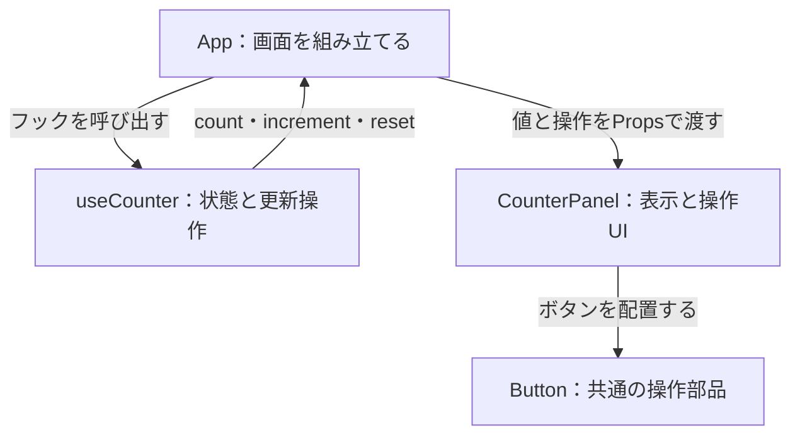
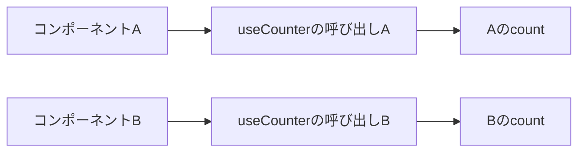
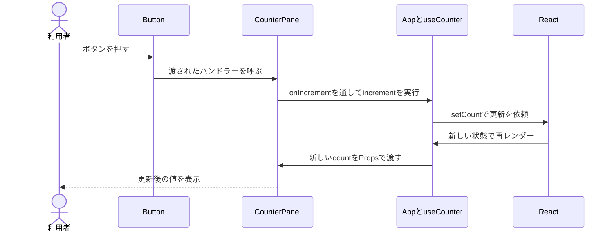

# 102. React・TypeScriptによるフロントエンド開発

## この章の目的

前章で作成したカウンター画面を，役割ごとに分割します。

画面の機能を大きく増やすのではなく，次の変更に対応しやすい構成へ整理することが目的です。

- コンポーネントの責務を分ける。
- Propsで受け渡す値と操作を型で表現する。
- 状態管理の処理をカスタムフックへ分ける。
- 状態から計算できる値を重複して保存しない。
- 共通部品と機能固有の部品を区別する。

本章では，追加の状態管理ライブラリは導入しません。

## 1. 前提条件

前章までに，次を完了していることを前提にします。

- React・TypeScriptのアプリケーションが動作する。
- Tailwind CSSのスタイルが適用される。
- カウントとリセットの操作ができる。
- ビルドとGASへの反映ができる。

コマンドは，アプリケーションのルートで実行します。

```sh
cd ~/git/gas-react-app
```

作業前に差分を確認します。

```sh
git status --short
```

未コミットの変更がある場合は，今回の変更と分けて整理してください。

## 2. この章で作成する構成

```text
src/
├── components/
│   └── Button.tsx
├── features/
│   └── counter/
│       ├── components/
│       │   └── CounterPanel.tsx
│       └── hooks/
│           └── useCounter.ts
├── App.tsx
├── index.css
└── main.tsx
```

| ファイル           | 役割                           |
|--------------------|--------------------------------|
| `Button.tsx`       | 複数の画面から利用できるボタン |
| `CounterPanel.tsx` | カウントの表示と操作UI         |
| `useCounter.ts`    | カウントの状態と更新操作       |
| `App.tsx`          | 画面全体の組み立て             |

`features/` は，機能単位で関連する実装をまとめるためのディレクトリです。

すべてのプロジェクトでこの構成が必須という意味ではありません。本ドキュメントでは，次章以降で機能を追加しやすくするために採用します。

### 2.1 部品と状態の関係



`useCounter` は描画されるコンポーネントではありません。Appから呼び出すカスタムフックです。

## 3. 共通ボタンを作成する

ディレクトリを作成します。

```sh
mkdir -p src/components
mkdir -p src/features/counter/components
mkdir -p src/features/counter/hooks
```

`src/components/Button.tsx` を新規作成します。

```tsx
import type {
  ComponentPropsWithoutRef,
} from "react";

type ButtonVariant = "primary" | "secondary";

type ButtonProps = Omit<
  ComponentPropsWithoutRef<"button">,
  "className"
> & {
  variant?: ButtonVariant;
};

const baseClasses = [
  "inline-flex min-h-11 items-center justify-center",
  "rounded-lg px-5 py-3 font-medium transition-colors",
  "focus-visible:outline-2 focus-visible:outline-offset-4",
  "focus-visible:outline-blue-700",
  "disabled:cursor-not-allowed disabled:opacity-50",
].join(" ");

const variantClasses: Record<ButtonVariant, string> = {
  primary:
    "bg-blue-700 text-white enabled:hover:bg-blue-800",
  secondary:
    "border border-slate-300 bg-white text-slate-800 enabled:hover:bg-slate-100",
};

export function Button({
  variant = "primary",
  type = "button",
  children,
  ...buttonProps
}: ButtonProps) {
  return (
    <button
      {...buttonProps}
      type={type}
      className={[
        baseClasses,
        variantClasses[variant],
      ].join(" ")}
    >
      {children}
    </button>
  );
}
```

### 3.1 標準のボタン属性を引き継ぐ

`ComponentPropsWithoutRef<"button">` を使用して，Reactのbutton要素で使える属性を引き継ぎます。

これにより，次の属性などを渡せます。

- `onClick`
- `disabled`
- `aria-label`
- `type`
- `children`

この部品ではrefの受け渡しは扱いません。

### 3.2 variantで見た目を選択する

`variant` は，次のどちらかに限定します。

```ts
type ButtonVariant = "primary" | "secondary";
```

誤った値を渡すと，TypeScriptの型チェックで検出できます。

```tsx
<Button variant="primary">保存</Button>
<Button variant="secondary">キャンセル</Button>
```

Tailwindのクラスは完全な文字列として記述し，`bg-${color}-700` のように組み立てません。

### 3.3 classNameを公開しない理由

このサンプルでは，共通ボタンの見た目を `variant` で選ぶ方針とし，`className` をPropsから除外しています。

呼び出し側で任意の競合クラスを追加できるようにすると，見た目の一貫性や優先関係を考える必要があるためです。

余白や配置は，まずボタンを囲む親要素で指定します。

これは設計上の選択です。必要に応じて，サイズなどのPropsを追加する方針も考えられます。

## 4. カウントの状態管理を分離する

`src/features/counter/hooks/useCounter.ts` を新規作成します。

```ts
import { useState } from "react";

export function useCounter() {
  const [count, setCount] = useState(0);

  function increment() {
    setCount((previous) => previous + 1);
  }

  function reset() {
    setCount(0);
  }

  return {
    count,
    increment,
    reset,
  };
}
```

### 4.1 フックの役割

このフックは，次の3つを返します。

| 戻り値      | 役割        |
|-------------|-------------|
| `count`     | 現在の値    |
| `increment` | 1増やす操作 |
| `reset`     | 0へ戻す操作 |

戻り値の型は，この小さな実装ではTypeScriptの推論を使用します。

`setCount` をそのまま公開するのではなく，操作名を持つ関数として返しています。呼び出し側は，状態をどう保存しているかではなく，どの操作ができるかに着目できます。

### 4.2 前の状態を使って更新する

前の値に基づいて次の値を計算する場合は，更新用の関数を渡します。

```ts
setCount((previous) => previous + 1);
```

更新関数は，次の状態を返すだけの純粋な処理にします。

通信，ログの保存，別の状態更新などを，この更新関数内へ入れないでください。

### 4.3 フックは状態を自動共有しない

同じカスタムフックを別々のコンポーネントから呼んでも，状態が自動的に共有されるわけではありません。



複数の部品で同じカウントを扱う場合は，共通の親で一度だけフックを呼び，値と操作をPropsで渡す構成にします。

## 5. カウンターの表示部品を作成する

`src/features/counter/components/CounterPanel.tsx` を新規作成します。

```tsx
import { Button } from "../../../components/Button";

type CounterPanelProps = {
  count: number;
  onIncrement: () => void;
  onReset: () => void;
};

export function CounterPanel({
  count,
  onIncrement,
  onReset,
}: CounterPanelProps) {
  const canReset = count !== 0;

  return (
    <section
      aria-labelledby="counter-title"
      className="rounded-2xl border border-slate-200 bg-white p-6 shadow-sm sm:p-10"
    >
      <h2
        id="counter-title"
        className="text-xl font-bold sm:text-2xl"
      >
        カウンター
      </h2>

      <p className="mt-4 leading-8 text-slate-700">
        ボタンを押して，状態の更新を確認してください。
      </p>

      <div className="mt-6 flex flex-col gap-3 sm:flex-row">
        <Button onClick={onIncrement}>
          カウントを増やす
        </Button>

        <Button
          variant="secondary"
          onClick={onReset}
          disabled={!canReset}
        >
          リセット
        </Button>
      </div>

      <p
        role="status"
        aria-live="polite"
        aria-atomic="true"
        className="mt-6 rounded-lg bg-slate-100 px-4 py-3 text-lg font-semibold"
      >
        現在のカウント：{count}
      </p>
    </section>
  );
}
```

### 5.1 Propsには値と操作を渡す

この部品は，カウントの状態を自分では保持しません。

親から渡された `count` を表示し，ボタンが押されたときに `onIncrement` や `onReset` を呼びます。

子がPropsを書き換えるのではなく，親が提供した操作を呼び出す構成です。

### 5.2 計算できる値を状態へ重複保存しない

リセット可能かどうかは，カウントから計算できます。

```ts
const canReset = count !== 0;
```

ここで別の `useState` を追加して `canReset` を保存すると，カウントとの同期が必要になります。

元の状態から計算できる値は，まず描画時に計算する方針とします。

### 5.3 同じ部品を複数配置する場合

この例は，画面内にCounterPanelを1つだけ配置する前提で，見出しIDを固定しています。

複数配置する場合は，IDの重複を避けるため，`useId()` を使用するか，固有のIDをPropsで渡すように変更してください。

## 6. Appで部品を組み立てる

`src/App.tsx` の内容全体を，次のコードへ置き換えます。

```tsx
import { CounterPanel } from "./features/counter/components/CounterPanel";
import { useCounter } from "./features/counter/hooks/useCounter";

export default function App() {
  const { count, increment, reset } = useCounter();

  return (
    <main className="min-h-screen bg-slate-100 px-4 py-8 text-slate-900 sm:px-8">
      <div className="mx-auto w-full max-w-2xl">
        <header className="mb-6">
          <p className="text-sm font-medium text-slate-600">
            Google Apps Script
          </p>

          <h1 className="mt-2 text-2xl font-bold tracking-tight sm:text-3xl">
            Reactで作るGASアプリ
          </h1>

          <p className="mt-3 leading-8 text-slate-700">
            コンポーネントと状態管理を分離したサンプルです。
          </p>
        </header>

        <CounterPanel
          count={count}
          onIncrement={increment}
          onReset={reset}
        />
      </div>
    </main>
  );
}
```

`src/main.tsx`，`src/index.css`，`vite.config.ts` は，前章の設定を維持します。

この章の変更だけで，GAS側のコードや配置準備スクリプトを変更する必要はありません。

## 7. データと操作の流れ



この図は，操作とデータの関係を示したものです。

実装では，親の関数参照を子へ渡しているため，子コンポーネント間で独自の通信処理が動いているわけではありません。

## 8. TypeScriptを使用する際の注意

### 8.1 型はコンポーネント間の契約を表す

CounterPanelは，数値と2つの操作を要求します。

```ts
type CounterPanelProps = {
  count: number;
  onIncrement: () => void;
  onReset: () => void;
};
```

値の渡し忘れや，文字列を数値の代わりに渡す誤りを，型チェックで検出できます。

### 8.2 型と実行時の検証は別

TypeScriptの型は，外部から届いたデータの内容を自動検証するものではありません。

将来，GASからデータを受け取る場合は，型を付けるだけでなく，必要な実行時検証も行います。

この章はローカルの数値状態だけを扱うため，外部データの検証処理は追加しません。

### 8.3 型だけのimportを区別する

Reactの型は，次のように `import type` で読み込みます。

```ts
import type {
  ComponentPropsWithoutRef,
} from "react";
```

テンプレートのTypeScript設定によっては，型を通常のimportで読み込むとエラーになります。

## 9. 状態と副作用を混同しない

今回のカウント更新には，`useEffect` は必要ありません。

- ボタン操作で値を増やす：イベントハンドラーで行う。
- リセットする：イベントハンドラーで行う。
- リセット可能か計算する：現在の状態から計算する。

外部システムとの同期がない処理を，すべてEffectへ移すことは避けます。

GASとの通信を追加する場合は，初期取得と利用者操作による保存を区別して設計します。具体的な内容は「104. Googleサービスとの連携」で扱います。

### 9.1 StrictModeを維持する

基本編の `main.tsx` にある `StrictMode` は維持します。

開発時には，コンポーネント本体や状態の更新関数などが追加で実行され，純粋でない処理の問題が見つかる場合があります。

この確認によって，ボタンのイベントハンドラー自体が自動的に2回呼ばれるわけではありません。

カウントが想定以上に増える場合は，状態の直接変更や，複数箇所からの更新がないかを確認してください。

## 10. 分割しすぎないための判断

すべてのHTML要素を，個別のコンポーネントにする必要はありません。

次の観点で分割を検討します。

| 観点       | 検討内容                             |
|------------|--------------------------------------|
| 責務       | 別の役割として説明できるか           |
| 再利用     | 複数箇所で同じ操作・見た目を使うか   |
| 読みやすさ | 画面全体の意図が追いやすくなるか     |
| 変更範囲   | 変更の影響を限定できるか             |
| 検証       | 入力と出力を分けて確認しやすくなるか |

今回のカスタムフックも，小規模なカウンターに必須のものではありません。

本章では，表示と状態管理を分ける例として使用しています。

## 11. ローカルで確認する

```sh
npm run typecheck
npm run dev
```

次を確認します。

- 画面が表示される。
- Tailwind CSSのスタイルが維持される。
- カウントが1ずつ増える。
- リセットで0へ戻る。
- 0のときはリセットが無効になる。
- キーボードで操作できる。
- 再読み込みで初期値へ戻る。
- Consoleにアプリ由来のエラーがない。

### 11.1 Propsの型チェックを試す場合

一時的に，Appの指定を次のように変更します。

```tsx
count="0"
```

型チェックでエラーになることを確認し，必ず元へ戻します。

```tsx
count={count}
```

確認用の誤ったコードを残したまま，次の作業へ進まないでください。

## 12. ビルドとGAS上で確認する

```sh
npm run build:gas
```

プレビューでも表示を確認します。

```sh
npm run preview -- --host 127.0.0.1 --port 4173 --strictPort
```

問題がなければ，送信対象を確認して反映します。

```sh
clasp show-file-status
clasp push
```

既存デプロイを新しいバージョンへ更新し，公開URLでも操作を確認します。

コンポーネントを複数ファイルへ分けても，ビルド後は既存のsinglefile設定によって配信用HTMLへまとめる構成を維持します。

Reactのソースファイルを，個別にGASへ送る構成へ変更する必要はありません。

## 13. よくある問題

### 13.1 import先が見つからない

次を確認します。

- 作成したディレクトリとファイル名
- 大文字と小文字
- 相対パスの階層
- ファイルを保存しているか

macOS上で気づきにくい大文字・小文字の違いが，別環境で問題になる場合があります。表記を統一してください。

### 13.2 ボタンが反応しない

次を確認します。

- `onClick` が渡されているか。
- CounterPanelへ操作を渡しているか。
- 意図せず `disabled` になっていないか。
- Consoleにエラーがないか。
- デバッガーで停止中ではないか。

### 13.3 複数のカウンターが連動しない

それぞれで `useCounter()` を呼んでいないか確認します。

同じ値を共有したい場合は，共通の親で状態を保持し，各部品へ値と操作を渡します。

### 13.4 再読み込みや画面の切り替えで値が戻る

このサンプルは，データの永続化を行っていません。

また，Reactの状態はコンポーネントツリー上の位置やマウント状態に影響されます。次章の画面遷移では，状態をどこで保持するかを改めて検討します。

### 13.5 共通ボタンの色が適用されない

Tailwindのクラス名が，完全な文字列としてソースに含まれることを確認します。

前章のVite設定とCSSのimportが維持されているかも確認してください。

## 14. Gitへ変更を記録する

```sh
git status --short
git diff
```

主な変更対象は次のとおりです。

- `src/components/Button.tsx`
- `src/features/counter/components/CounterPanel.tsx`
- `src/features/counter/hooks/useCounter.ts`
- `src/App.tsx`

確認後，コミットします。

```sh
git add .
git diff --cached
git commit -m '画面部品とカウンターの状態管理を分離'
```

## 15. この章の確認

- [ ] 共通のButtonを作成した。
- [ ] Propsの型を定義した。
- [ ] カスタムフックへ状態管理を分離した。
- [ ] CounterPanelへ表示と操作UIを分離した。
- [ ] Appで値と操作を接続した。
- [ ] カスタムフックが状態を自動共有しないことを理解した。
- [ ] 計算できる値を重複して状態保存しないことを確認した。
- [ ] 型チェックが成功した。
- [ ] ローカルで操作を確認した。
- [ ] ビルドとプレビューを確認した。
- [ ] GAS上でも表示と操作を確認した。
- [ ] Gitへ変更を記録した。

次の章では，React RouterのHash方式を使用し，複数画面を持つSPAへ拡張します。

## 参考資料

- [ReactでTypeScriptを使用する](https://react.dev/learn/typescript)
- [コンポーネントへPropsを渡す](https://react.dev/learn/passing-props-to-a-component)
- [コンポーネント間で状態を共有する](https://react.dev/learn/sharing-state-between-components)
- [状態構造の選び方](https://react.dev/learn/choosing-the-state-structure)
- [カスタムフックでロジックを再利用する](https://react.dev/learn/reusing-logic-with-custom-hooks)
- [Effectが不要な場合](https://react.dev/learn/you-might-not-need-an-effect)
- [StrictMode](https://react.dev/reference/react/StrictMode)

---

[前の章：Tailwind CSSによるスタイリング](101-tailwindcss.md) | [目次へ戻る](../../README.md) | [次の章：SPAと画面遷移](103-spa-application.md)
