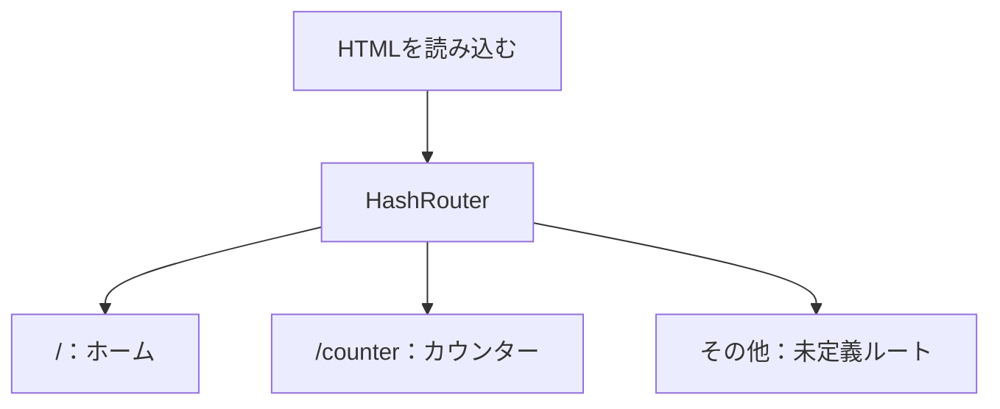
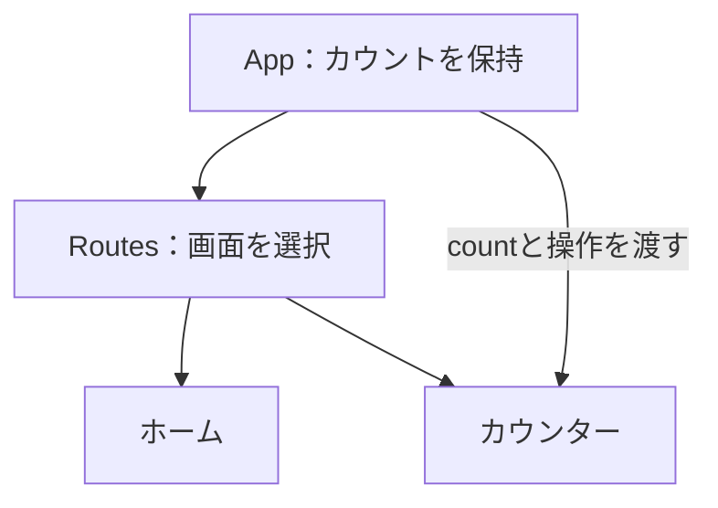

# 103. SPAと画面遷移

## この章の目的

React RouterのHash方式を使用し，単一画面のアプリケーションを複数画面へ拡張します。

この章では，次の内容を扱います。

- SPAにおける画面遷移
- HashRouterの導入
- 共通レイアウトとルート定義
- LinkとNavLinkによる移動
- 画面遷移時の状態保持
- 未定義ルートの表示
- GASのiframe環境における注意点

本章では，React Router v7系のDeclarativeモードを使用します。Frameworkモードやサーバーレンダリングは使用しません。

## 1. 前提条件

前章で作成した次の実装を使用します。

```text
src/
├── components/
│   └── Button.tsx
├── features/
│   └── counter/
│       ├── components/
│       │   └── CounterPanel.tsx
│       └── hooks/
│           └── useCounter.ts
├── App.tsx
├── index.css
└── main.tsx
```

コマンドはアプリケーションのルートで実行します。

```sh
cd ~/git/gas-react-app
```

作業前に差分を確認してください。

```sh
git status --short
```

## 2. SPAとHash方式

SPAでは，最初に読み込んだ画面の中で，表示するコンポーネントを切り替えます。

本章では，ルートを次のように定義します。

| アプリ内部のルート | 表示する内容                 |
|--------------------|------------------------------|
| `/`                | ホーム                       |
| `/counter`         | カウンター                   |
| その他             | ページが見つからない旨の表示 |

HashRouterは，URLの `#` 以降を使ってルートを管理します。

ローカルで直接開く場合の例：

```text
http://localhost:5173/#/
http://localhost:5173/#/counter
```

ハッシュ部分はHTTPリクエストでサーバーへ送信されません。サーバー側に `/counter` という配信パスを追加せず，ブラウザ内で表示を切り替えます。



### 2.1 GAS上のURLに関する注意

GASのHTMLサービスでは，アプリケーションはiframe内で動作します。

HashRouterは，標準ではアプリケーションが動いているwindowのハッシュを扱います。そのため，ルートを変更しても，外側のブラウザのアドレスバーに同じハッシュが表示されるとは限りません。

本章で実装するのは，iframe内の画面遷移です。

次の機能を，自動的に実現できるとは考えないでください。

- 外側の `/exec` URLに `#/counter` を付けた直接アクセス
- アドレスバーのURLをコピーするだけでの表示画面の共有
- 再読み込み後の同じ画面への復帰

これらが必要な場合は，GASの `google.script.url` や `google.script.history` などを含め，外側のURLとアプリのルートを同期する設計を別途検討します。

`window.top` をHashRouterへ無条件に渡す方法は採用しません。iframeのオリジンやアクセス制約を無視した実装になるためです。

## 3. React Routerを導入する

```sh
npm install react-router@7
```

導入結果を確認します。

```sh
npm ls react-router
```

本章では，ブラウザ用のコンポーネントも `react-router` からimportします。

別バージョンや既存の `react-router-dom` ベースのサンプルを混在させないでください。

## 4. この章で追加するファイル

```text
src/
├── layouts/
│   └── AppLayout.tsx
├── pages/
│   ├── HomePage.tsx
│   └── NotFoundPage.tsx
├── components/
│   └── Button.tsx
├── features/
│   └── counter/
│       ├── components/
│       │   └── CounterPanel.tsx
│       └── hooks/
│           └── useCounter.ts
├── App.tsx
├── index.css
└── main.tsx
```

ディレクトリを作成します。

```sh
mkdir -p src/layouts src/pages
```

## 5. 共通レイアウトを作成する

`src/layouts/AppLayout.tsx` を新規作成します。

```tsx
import { NavLink, Outlet } from "react-router";

function navigationClassName({
  isActive,
}: {
  isActive: boolean;
}) {
  const base = [
    "rounded-lg px-4 py-2 font-medium",
    "focus-visible:outline-2",
    "focus-visible:outline-offset-4",
    "focus-visible:outline-blue-700",
  ].join(" ");

  const state = isActive
    ? "bg-blue-700 text-white"
    : "bg-white text-slate-700 hover:bg-slate-200";

  return `${base} ${state}`;
}

export function AppLayout() {
  return (
    <div className="min-h-screen bg-slate-100 text-slate-900">
      <header className="border-b border-slate-200 bg-white">
        <div className="mx-auto w-full max-w-3xl px-4 py-6 sm:px-8">
          <p className="text-sm font-medium text-slate-600">
            Google Apps Script
          </p>

          <h1 className="mt-2 text-2xl font-bold tracking-tight">
            Reactで作るGASアプリ
          </h1>

          <nav
            aria-label="メインナビゲーション"
            className="mt-5 flex flex-wrap gap-2"
          >
            <NavLink
              to="/"
              end
              className={navigationClassName}
            >
              ホーム
            </NavLink>

            <NavLink
              to="/counter"
              className={navigationClassName}
            >
              カウンター
            </NavLink>
          </nav>
        </div>
      </header>

      <main className="mx-auto w-full max-w-3xl px-4 py-8 sm:px-8">
        <Outlet />
      </main>
    </div>
  );
}
```

### 5.1 Outletの役割

`Outlet` には，現在の子ルートに対応する画面が表示されます。

ヘッダーやナビゲーションを共通化し，画面固有の部分だけを切り替えます。

### 5.2 NavLinkの役割

NavLinkを使用すると，現在のルートに対応するリンクの見た目を切り替えられます。

アクティブなリンクには `aria-current="page"` も付与されます。

画面内の見出しを読む順序や，移動後のフォーカス管理まで自動的に解決するものではありません。画面が複雑になる場合は，フォーカスや画面タイトルの通知も設計してください。

## 6. ホーム画面を作成する

`src/pages/HomePage.tsx` を新規作成します。

```tsx
import { Link } from "react-router";

export function HomePage() {
  return (
    <section
      aria-labelledby="home-title"
      className="rounded-2xl border border-slate-200 bg-white p-6 shadow-sm sm:p-10"
    >
      <h2
        id="home-title"
        className="text-xl font-bold sm:text-2xl"
      >
        ホーム
      </h2>

      <p className="mt-4 leading-8 text-slate-700">
        React Routerを使用したSPAのサンプルです。
        ナビゲーションから画面を切り替えられます。
      </p>

      <Link
        to="/counter"
        className="mt-6 inline-block rounded text-blue-800 underline underline-offset-4 focus-visible:outline-2 focus-visible:outline-offset-4 focus-visible:outline-blue-700"
      >
        カウンターを開く
      </Link>
    </section>
  );
}
```

アプリ内部の移動には，通常のパスを指定した `<a>` ではなく，React RouterのLinkまたはNavLinkを使用します。

移動のための要素はリンクとして実装し，ButtonをLinkで囲むなどの対話要素の入れ子は避けます。

## 7. 未定義ルートの画面を作成する

`src/pages/NotFoundPage.tsx` を新規作成します。

```tsx
import { Link } from "react-router";

export function NotFoundPage() {
  return (
    <section
      aria-labelledby="not-found-title"
      className="rounded-2xl border border-slate-200 bg-white p-6 shadow-sm sm:p-10"
    >
      <h2
        id="not-found-title"
        className="text-xl font-bold sm:text-2xl"
      >
        ページが見つかりません
      </h2>

      <p className="mt-4 leading-8 text-slate-700">
        指定された画面は，このアプリケーションにありません。
      </p>

      <Link
        to="/"
        className="mt-6 inline-block rounded text-blue-800 underline underline-offset-4 focus-visible:outline-2 focus-visible:outline-offset-4 focus-visible:outline-blue-700"
      >
        ホームへ戻る
      </Link>
    </section>
  );
}
```

これはブラウザ内の未定義ルートに対する画面です。HTTPレスポンスのステータスを404へ変更する実装ではありません。

## 8. Appへルートを定義する

`src/App.tsx` の内容全体を置き換えます。

```tsx
import { Route, Routes } from "react-router";
import { CounterPanel } from "./features/counter/components/CounterPanel";
import { useCounter } from "./features/counter/hooks/useCounter";
import { AppLayout } from "./layouts/AppLayout";
import { HomePage } from "./pages/HomePage";
import { NotFoundPage } from "./pages/NotFoundPage";

export default function App() {
  const { count, increment, reset } = useCounter();

  return (
    <Routes>
      <Route element={<AppLayout />}>
        <Route index element={<HomePage />} />

        <Route
          path="counter"
          element={
            <CounterPanel
              count={count}
              onIncrement={increment}
              onReset={reset}
            />
          }
        />

        <Route
          path="*"
          element={<NotFoundPage />}
        />
      </Route>
    </Routes>
  );
}
```

`path="*"` は，他のルートに一致しない場合に使用します。

この章ではルート定義が少ないため，App内にまとめます。画面数が増えた場合は，ルート定義やページコンポーネントの分割を検討します。

## 9. HashRouterを配置する

`src/main.tsx` の内容全体を置き換えます。

```tsx
import { StrictMode } from "react";
import { createRoot } from "react-dom/client";
import { HashRouter } from "react-router";
import App from "./App";
import "./index.css";

const rootElement = document.getElementById("root");

if (!rootElement) {
  throw new Error("画面の描画先が見つかりません。");
}

createRoot(rootElement).render(
  <StrictMode>
    <HashRouter>
      <App />
    </HashRouter>
  </StrictMode>,
);
```

HashRouterはアプリケーション全体を一度だけ囲みます。

Appや各ページで，重ねて別のRouterを配置しないでください。

## 10. 画面を切り替えたときの状態

本章では，`useCounter()` をAppで呼び出しています。

そのため，カウンター画面が表示されていない間も，Appがマウントされている限り，カウントは維持されます。



次の操作を試します。

1. カウンター画面を開く。
2. カウントを増やす。
3. ホームへ移動する。
4. カウンター画面へ戻る。
5. 値が維持されていることを確認する。

ブラウザの再読み込みでは，App自体の状態が初期化されます。

画面遷移による状態保持と，永続化は別です。GASやストレージへの保存は追加していません。

## 11. ローカルで確認する

```sh
npm run typecheck
npm run dev
```

ターミナルに表示されたURLを使用します。

### 11.1 通常の画面遷移

次を確認します。

- ホームが表示される。
- ナビゲーションからカウンターへ移動できる。
- 現在のリンクの見た目が変わる。
- カウンターを操作できる。
- ホームを経由してもカウントが維持される。
- ブラウザの戻る・進むで遷移を確認できる。
- キーボードでリンクを操作できる。

### 11.2 未定義ルート

ローカルのURLのハッシュを，存在しないルートへ変更します。

```text
http://localhost:5173/#/unknown
```

起動先が異なる場合は，ホスト名とポートを実際のものに合わせてください。

未定義ルートの画面と，ホームへ戻るリンクを確認します。

### 11.3 カウンターへの直接アクセス

ローカルでは，次の形式で直接アクセスできます。

```text
http://localhost:5173/#/counter
```

再読み込み後もカウンター画面を表示し，カウント自体は0へ戻ることを確認します。

このローカルでの動作を，そのままGASの外側のURLにも適用できるとは考えないでください。

## 12. ビルドとGAS上で確認する

```sh
npm run build:gas
```

プレビューでも画面遷移を確認します。

```sh
npm run preview -- --host 127.0.0.1 --port 4173 --strictPort
```

問題がなければ反映します。

```sh
clasp show-file-status
clasp push
```

既存デプロイを新しいバージョンへ更新し，公開URLで確認します。

### 12.1 GAS上での確認項目

- 初期画面が表示される。
- LinkとNavLinkで画面を切り替えられる。
- 遷移中に不要な外部ページへ移動しない。
- カウントが画面遷移を挟んでも維持される。
- Consoleにアプリ由来のエラーがない。
- ブラウザの戻る・進むを操作したときの挙動を確認する。
- 再読み込み後のルートと状態を確認する。

iframe内の履歴と外側のページの履歴が関係するため，履歴操作はGAS上で実際に確認してください。

### 12.2 ハッシュを調査する場合

開発者ツールのConsoleで，アプリが動いているiframeのコンテキストを選びます。

次の式で，アプリ側のハッシュを確認できます。

```js
window.location.hash
```

外側のページのコンテキストと混同しないようにしてください。

## 13. URLとルーティングの注意点

### 13.1 GASの配信パスへ画面名を追加しない

本章の構成では，次のようなURLを画面遷移用に作りません。

```text
[https://script.google.com/macros/s/DEPLOYMENT_ID/exec/counter](https://script.google.com/macros/s/DEPLOYMENT_ID/exec/counter)
```

本章で用意したのは，GASのサーバールーティングではなく，HashRouterによるブラウザ内のルーティングです。

### 13.2 ルートの非表示はアクセス制御ではない

ナビゲーションからリンクを消しても，その画面や機能の権限管理にはなりません。

Googleサービスへのアクセスや更新処理では，GAS側でも必要な認証・認可・入力検証を実施します。

### 13.3 URLへ秘密情報を入れない

ハッシュであっても，ブラウザ内のコードや画面共有などを通じて参照され得ます。

トークンや秘密情報をルートやクエリの値に含めないでください。

### 13.4 通常のアンカーとの競合

HashRouterはハッシュをルート管理に使います。

同じアプリで `<a href="#section">` のようなページ内リンクを使う場合は，ルートの変更と競合しないか確認します。

## 14. よくある問題

### 14.1 Routerの外でLinkを使用しているというエラー

`main.tsx` でAppがHashRouterに囲まれているか確認します。

テストや別の描画入口を追加した場合も，同じ前提を確認してください。

### 14.2 Routerを重ねて配置したというエラー

`main.tsx`，App，各ページに，複数のRouterを追加していないか確認します。

本章では `main.tsx` のHashRouterだけを使用します。

### 14.3 ナビゲーションだけ表示されて画面が出ない

AppLayoutに `Outlet` があるか，子ルートが定義されているか確認します。

### 14.4 カウンターへ戻ると値が初期化される

`useCounter()` をCounterPanel側へ移していないか確認します。

この章では，ルート変更後も残るAppが状態を保持します。

### 14.5 GASのアドレスバーにハッシュが表示されない

iframe内でルートが管理されている可能性があります。

アドレスバーの変化だけで失敗と判断せず，画面遷移とiframe内の `window.location.hash` を確認します。

外側のURLとの同期が必要な場合は，本章とは別の実装として設計してください。

### 14.6 GASのURLへハッシュを付けても直接表示できない

外側のURLのハッシュが，iframe内のHashRouterへ自動的に引き継がれるとは限りません。

直接リンクやブックマーク対応は，外側のURLから初期ルートを取り込む処理と，遷移時のURL同期を含めて検討します。

## 15. Gitへ変更を記録する

```sh
git status --short
git diff
```

主な変更対象は次のとおりです。

- `package.json`
- `package-lock.json`
- `src/main.tsx`
- `src/App.tsx`
- `src/layouts/AppLayout.tsx`
- `src/pages/HomePage.tsx`
- `src/pages/NotFoundPage.tsx`

確認後，コミットします。

```sh
git add .
git diff --cached
git commit -m 'Hash方式の画面遷移を追加'
```

## 16. この章の確認

- [ ] React Router v7系を導入した。
- [ ] main.tsxにHashRouterを配置した。
- [ ] Appにルートを定義した。
- [ ] 共通レイアウトとOutletを作成した。
- [ ] LinkとNavLinkで移動できる。
- [ ] 未定義ルートの画面を確認した。
- [ ] 画面遷移を挟んだ状態保持を確認した。
- [ ] 再読み込みと永続化の違いを理解した。
- [ ] ローカルで直接アクセスを確認した。
- [ ] ビルドとプレビューを確認した。
- [ ] GAS上で画面遷移と履歴操作を確認した。
- [ ] iframe内のルートと外側のURLの違いを理解した。
- [ ] Gitへ変更を記録した。

次の章では，フロントエンドからGASを呼び出し，Googleサービスと連携する機能を追加します。

## 参考資料

- [React Router v7のHashRouter](https://reactrouter.com/7.9.6/api/declarative-routers/HashRouter)
- [React RouterのHashRouter](https://reactrouter.com/api/declarative-routers/HashRouter)
- [React RouterのLink](https://reactrouter.com/api/components/Link)
- [React RouterのNavLink](https://reactrouter.com/api/components/NavLink)
- [GASのHTMLサービスの制限](https://developers.google.com/apps-script/guides/html/restrictions)
- [google.script.url](https://developers.google.com/apps-script/guides/html/reference/url)
- [google.script.history](https://developers.google.com/apps-script/guides/html/reference/history)

---

[前の章：React・TypeScriptによるフロントエンド開発](102-modern-frontend.md) | [目次へ戻る](../../README.md) | [次の章：Googleサービスとの連携](104-use-google-services.md)
