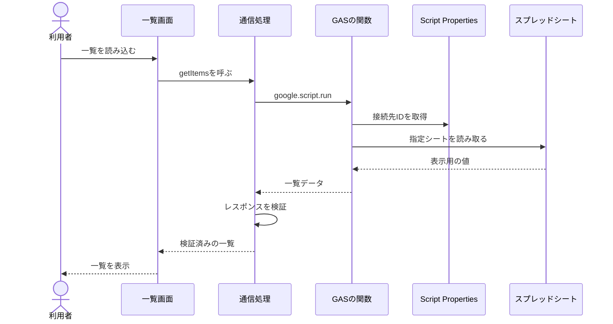
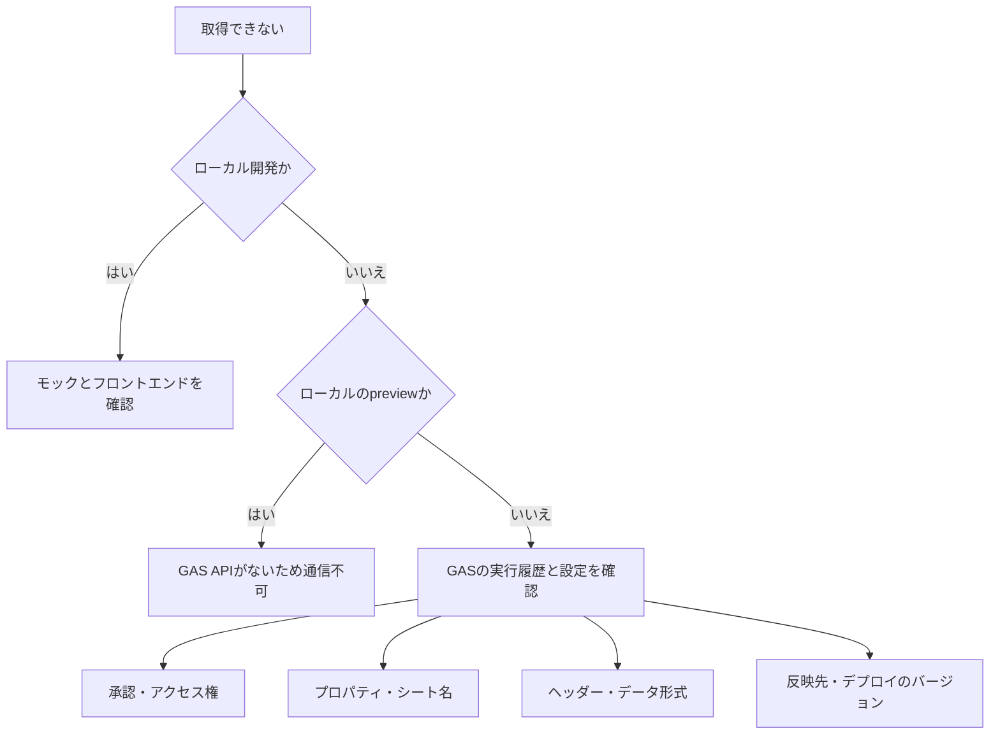

# 104. Googleサービスとの連携

## この章の目的

画面からGASの関数を呼び出し，Googleスプレッドシートに保存した一覧を表示します。

この章では，次を実装します。

- スプレッドシートの読み取り
- Script Propertiesによる接続先の設定
- google.script.runのPromise化
- レスポンスの実行時検証
- ローカル開発用のモック
- 読み込み中・成功・空・失敗の表示

サンプルは読み取り専用です。書き込み，利用者別のデータ分離，大量データの取得は対象外とします。

## 1. 前提条件と公開範囲

前章のSPA構成と，基本編のデプロイ手順を使用します。

```sh
cd ~/git/gas-react-app
git status --short
```

この章では，次の条件を守ってください。

- 学習用のスプレッドシートを新規作成する。
- 顧客情報や個人情報を使用しない。
- デプロイは「自分として実行」とする。
- アクセス範囲は自分だけに限定する。
- 実行するアカウントが対象シートへアクセスできることを確認する。

自分として実行するウェブアプリは，所有者の権限でデータを読み取ります。公開範囲を広げると，元のシートへの直接アクセス権を持たない利用者にも，サーバーが返すデータを配信し得ます。

本サンプルは，複数利用者向けの認可を実装していません。アクセス範囲を広げる前に，サーバー側の認可設計を追加してください。

## 2. 処理の全体像



ローカル開発時は，通信処理がモックデータを返します。GAS側の処理は実行しません。

## 3. 学習用データを用意する

Googleスプレッドシートを新規作成し，シート名を `items` にします。

A1から次の表を入力してください。

| id       | name          |
|----------|---------------|
| item-001 | サンプル項目A |
| item-002 | サンプル項目B |
| item-003 | サンプル項目C |

1行目をヘッダー，2行目以降をデータとして扱います。

スプレッドシートのURLからIDを確認します。

```text
[https://docs.google.com/spreadsheets/d/SPREADSHEET_ID/edit](https://docs.google.com/spreadsheets/d/SPREADSHEET_ID/edit)
```

`SPREADSHEET_ID` の部分が対象のIDです。シートのタブを示す `gid` とは異なります。

## 4. GASに接続先を設定する

```sh
clasp open-script
```

GASエディタのプロジェクト設定で，「スクリプト プロパティ」に次を追加します。

| プロパティ       | 値                         |
|------------------|----------------------------|
| `SPREADSHEET_ID` | 学習用スプレッドシートのID |

Script Propertiesは，スクリプト単位の設定を保存する場所です。利用者ごとの設定ではありません。

設定値はフロントエンドへ返さず，GAS側だけで使用します。

Script Propertiesは専用の秘密情報保管基盤ではなく，プロジェクトの編集者やスクリプトから扱える設定です。秘密情報を扱う場合は，編集権限や管理方針も検討してください。

## 5. GAS側の読み取り関数を追加する

`gas/Code.js` の既存の `doGet()` は維持し，末尾に次を追記します。

```js
function getItems() {
  try {
    const spreadsheetId = PropertiesService
      .getScriptProperties()
      .getProperty("SPREADSHEET_ID");

    if (!spreadsheetId) {
      throw new Error("SPREADSHEET_ID is not configured.");
    }

    const spreadsheet =
      SpreadsheetApp.openById(spreadsheetId);

    const sheet = spreadsheet.getSheetByName("items");

    if (!sheet) {
      throw new Error("The items sheet does not exist.");
    }

    const header = sheet
      .getRange(1, 1, 1, 2)
      .getDisplayValues();

    if (header !== "id" || header !== "name") {
      throw new Error("Unexpected header.");
    }

    const lastRow = sheet.getLastRow();

    if (lastRow <= 1) {
      return [];
    }

    // この学習用APIは，ヘッダーを除く最大100行に限定します。
    if (lastRow > 101) {
      throw new Error("The sample row limit was exceeded.");
    }

    const rows = sheet
      .getRange(2, 1, lastRow - 1, 2)
      .getDisplayValues();

    const items = [];
    const ids = new Set();

    for (const row of rows) {
      const id = row.trim();
      const name = row.trim();

      if (!id && !name) {
        continue;
      }

      if (!id || !name || ids.has(id)) {
        throw new Error("Invalid item data.");
      }

      ids.add(id);
      items.push({ id, name });
    }

    return items;
  } catch (error) {
    // セルの内容や接続先IDはログへ出しません。
    console.error(
      "getItems failed",
      error instanceof Error ? error.name : "UnknownError",
    );

    throw new Error(
      "一覧を取得できませんでした。設定と権限を確認してください。",
    );
  }
}
```

### 5.1 クライアントから接続先を受け取らない

対象スプレッドシートは，サーバー側の設定から決定します。

ブラウザから任意のスプレッドシートIDを受け取り，所有者権限で読み取るAPIにはしません。

### 5.2 表示用の文字列を返す

`getDisplayValues()` を使い，セルの表示値を文字列として読み取ります。

`google.script.run` では，Date，Function，循環参照などをそのまま受け渡せません。日付を返す場合も，ISO形式などの文字列へ変換し，データ形式を明確にします。

表示値はシートの書式やロケールに影響されます。数値計算や厳密な日時処理を追加する場合は，表示文字列とは別のデータ形式を設計してください。

### 5.3 取得件数の制限

この例は小規模な学習用です。

行数が上限を超えた場合は，一部だけを黙って返さずエラーにします。大規模な一覧では，ページング，検索条件，返却件数の上限を別途設計します。

## 6. 通信処理を作成する

ディレクトリを作成します。

```sh
mkdir -p src/features/items/api
```

`src/features/items/api/itemsApi.ts` を新規作成します。

```ts
export type Item = {
  id: string;
  name: string;
};

type GasRunner = {
  withSuccessHandler(
    handler: (value: unknown) => void,
  ): GasRunner;
  withFailureHandler(
    handler: (error: unknown) => void,
  ): GasRunner;
  getItems(): void;
};

type GasWindow = Window & {
  google?: {
    script?: {
      run?: GasRunner;
    };
  };
};

function parseItems(value: unknown): Item[] {
  if (!Array.isArray(value) || value.length > 100) {
    throw new Error("一覧データの形式が正しくありません。");
  }

  const ids = new Set<string>();

  return value.map((entry: unknown) => {
    if (
      typeof entry !== "object" ||
      entry === null ||
      !("id" in entry) ||
      !("name" in entry) ||
      typeof entry.id !== "string" ||
      typeof entry.name !== "string"
    ) {
      throw new Error("一覧データの形式が正しくありません。");
    }

    const id = entry.id.trim();
    const name = entry.name.trim();

    if (!id || !name || ids.has(id)) {
      throw new Error("一覧データの内容が正しくありません。");
    }

    ids.add(id);

    return { id, name };
  });
}

async function getMockItems(): Promise<Item[]> {
  await new Promise<void>((resolve) => {
    window.setTimeout(resolve, 500);
  });

  return parseItems([
    { id: "item-001", name: "サンプル項目A" },
    { id: "item-002", name: "サンプル項目B" },
    { id: "item-003", name: "サンプル項目C" },
  ]);
}

export async function getItems(): Promise<Item[]> {
  if (import.meta.env.DEV) {
    return getMockItems();
  }

  const runner = (window as GasWindow)
    .google?.script?.run;

  if (!runner) {
    throw new Error(
      "GASの通信機能を利用できません。GAS上で確認してください。",
    );
  }

  const result = await new Promise<unknown>(
    (resolve, reject) => {
      runner
        .withSuccessHandler(resolve)
        .withFailureHandler(() => {
          reject(
            new Error(
              "一覧を取得できませんでした。時間をおいて再試行してください。",
            ),
          );
        })
        .getItems();
    },
  );

  return parseItems(result);
}
```

### 6.1 unknownで受けてから検証する

TypeScriptの型宣言だけでは，GASから返された値の形は保証されません。

レスポンスは `unknown` で受け取り，配列，文字列，必須項目，IDの重複を検証してから画面へ渡します。

### 6.2 モックへ切り替える条件

本章は `import.meta.env.DEV` を使用します。

| 実行方法                            | 使用するデータ                              |
|-------------------------------------|---------------------------------------------|
| `npm run dev`                       | モック                                      |
| 通常の本番ビルドを `preview` で表示 | GAS通信を試みるため，ローカルでは通信エラー |
| GAS上の本番ビルド                   | GASから取得                                 |

プレビューで通信エラーになることは，この構成では想定内です。

GASのAPIがないときに，本番でも黙ってモックを表示する実装にはしません。

### 6.3 型宣言の範囲

この例のGasRunnerは，本章で使うメソッドだけを表しています。GASのクライアントAPI全体を定義するものではありません。

APIが増えた段階で，型定義の共通化や生成方法を検討します。

## 7. 一覧画面を作成する

`src/pages/ItemsPage.tsx` を新規作成します。

```tsx
import { useEffect, useState } from "react";
import { Button } from "../components/Button";
import { getItems } from "../features/items/api/itemsApi";
import type { Item } from "../features/items/api/itemsApi";

type LoadState =
  | { status: "loading" }
  | { status: "success"; items: Item[] }
  | { status: "error"; message: string };

export function ItemsPage() {
  const [state, setState] = useState<LoadState>({
    status: "loading",
  });
  const [requestKey, setRequestKey] = useState(0);

  useEffect(() => {
    let ignore = false;

    async function load() {
      try {
        const items = await getItems();

        if (!ignore) {
          setState({ status: "success", items });
        }
      } catch (error) {
        if (!ignore) {
          setState({
            status: "error",
            message:
              error instanceof Error
                ? error.message
                : "一覧を取得できませんでした。",
          });
        }
      }
    }

    void load();

    return () => {
      ignore = true;
    };
  }, [requestKey]);

  function reload() {
    setState({ status: "loading" });
    setRequestKey((previous) => previous + 1);
  }

  return (
    <section
      aria-labelledby="items-title"
      aria-busy={state.status === "loading"}
      className="rounded-2xl border border-slate-200 bg-white p-6 shadow-sm sm:p-10"
    >
      <h2
        id="items-title"
        className="text-xl font-bold sm:text-2xl"
      >
        スプレッドシートの一覧
      </h2>

      <p className="mt-3 text-sm text-slate-600">
        {import.meta.env.DEV
          ? "ローカル用のモックを表示します。"
          : "GAS経由でデータを取得します。"}
      </p>

      <div className="mt-5">
        <Button
          onClick={reload}
          disabled={state.status === "loading"}
        >
          再読み込み
        </Button>
      </div>

      {state.status === "loading" && (
        <p role="status" className="mt-6">
          読み込み中です。
        </p>
      )}

      {state.status === "error" && (
        <p
          role="alert"
          className="mt-6 rounded-lg bg-red-50 p-4 text-red-800"
        >
          {state.message}
        </p>
      )}

      {state.status === "success" &&
        (state.items.length === 0 ? (
          <p role="status" className="mt-6">
            データはありません。
          </p>
        ) : (
          <ul className="mt-6 space-y-3">
            {state.items.map((item) => (
              <li
                key={item.id}
                className="rounded-lg border border-slate-200 p-4"
              >
                <p className="font-medium">{item.name}</p>
                <p className="mt-1 text-sm text-slate-600">
                  {item.id}
                </p>
              </li>
            ))}
          </ul>
        ))}
    </section>
  );
}
```

### 7.1 状態を組み合わせで表す

loading，success，errorを別々の真偽値にせず，判別可能なユニオン型で表します。

これにより，「読み込み中なのにエラー表示も有効」といった不整合を減らします。

### 7.2 古い結果を反映しない

Effectのクリーンアップで `ignore` をtrueにし，画面を離れた後や，再取得後に古い結果を反映しないようにします。

これは通信自体を中断する処理ではありません。

StrictModeでは開発時にEffectの追加実行が行われる場合があります。本章の処理は読み取り専用ですが，書き込み処理を同じ感覚で初期表示のEffectへ入れないでください。

### 7.3 文字列として表示する

取得した値は通常のJSXの文字列として表示します。

スプレッドシートのセルをHTMLとして挿入するために，`dangerouslySetInnerHTML` を使用しないでください。

## 8. ルートとナビゲーションを追加する

### 8.1 App.tsx

既存のAppへimportを追加します。

```tsx
import { ItemsPage } from "./pages/ItemsPage";
```

AppLayoutを使用する親Routeの内側で，`path="*"` のルートより前に追加します。

```tsx
<Route path="items" element={<ItemsPage />} />
```

既存のホームとカウンターのルート，Appで保持しているカウンター状態は維持します。

### 8.2 AppLayout.tsx

既存のnav要素の内側に，次を追加します。

```tsx
<NavLink
  to="/items"
  className={navigationClassName}
>
  一覧
</NavLink>
```

これで，ナビゲーションから一覧画面へ移動できます。

## 9. ローカルで確認する

```sh
npm run typecheck
npm run dev
```

一覧へ移動し，次を確認します。

- 読み込み中の表示が出る。
- モックの3件が表示される。
- 再読み込みできる。
- 読み込み中はボタンが無効になる。
- 別画面へ移動して戻っても正常に取得できる。
- Consoleにアプリ由来のエラーがない。

### 9.1 空データ

`getMockItems()` の戻り値を，一時的に次へ変更します。

```ts
return parseItems([]);
```

空の表示を確認したら元へ戻します。

### 9.2 取得失敗

`getMockItems()` の本体を，一時的に次へ変更します。

```ts
throw new Error("モックの取得失敗です。");
```

エラー表示と再試行操作を確認したら元へ戻します。

### 9.3 不正なレスポンス

モックに，一時的に型の異なる値を渡します。

```ts
return parseItems([{ id: 123, name: "不正なデータ" }]);
```

実行時検証でエラーになることを確認したら元へ戻します。

調査用の変更を残したままGASへ反映しないでください。

## 10. GAS側の承認とデプロイ

### 10.1 ビルドして反映する

```sh
npm run build:gas
clasp show-file-status
clasp push
```

GASの関数を `gas/Code.js` へ追記したため，基本編の3ファイル構成を維持できます。

別のGASファイルへ分割する場合は，配置準備スクリプトと `.claspignore` の更新も必要です。

### 10.2 GASエディタでgetItemsを実行する

```sh
clasp open-script
```

エディタの関数選択で `getItems` を選び，一度実行します。

Googleサービスへのアクセス承認が必要な場合は，対象アカウントと権限を確認して承認します。

エラーになる場合は，次を確認します。

- Script Propertiesの設定
- 対象スプレッドシートへのアクセス権
- シート名
- ヘッダー
- 行数とデータ形式

ローカルの `.env` にIDを記載しても，GASのScript Propertiesへ自動反映されるわけではありません。

### 10.3 既存デプロイを更新する

GASエディタで既存デプロイを編集し，新しいバージョンへ更新します。

実行ユーザーとアクセス範囲が，本章の前提から変わっていないことも確認してください。

### 10.4 公開URLで確認する

公開URLを開き，一覧へ移動します。

学習用シートの値が表示されることを確認します。

シートの項目名を変更し，画面の「再読み込み」で変更後の値を取得できることも確認します。

セルの値だけを変えた場合は，コードのビルドや再デプロイは不要です。

## 11. 障害時の確認



### 11.1 サーバー側の詳細を画面へ返さない

本章では，GAS側の内部エラーを，利用者向けのメッセージに置き換えます。

詳細な調査が必要な場合は，GASの実行履歴を確認し，学習用の環境で段階的に切り分けます。

運用向けには，機密情報を含めないエラーコードや相関IDなどを追加し，利用者向け表示と開発者向けログを分離する方針を検討してください。

### 11.2 読み込みが終わらない場合

この最小実装には，アプリ独自のタイムアウトや自動再試行を追加していません。

運用向けには，待機時間の上限や手動再試行を設計します。ただし，ブラウザ側で待機を打ち切ってもGAS側の処理が中断されるとは限りません。

特に書き込みでは，自動再試行による二重実行を防ぐ設計が必要です。

## 12. 他のGoogleサービスへ広げる場合

同じ責務分離を維持します。

| 層             | 役割                         |
|----------------|------------------------------|
| 画面           | 入力，操作，状態の表示       |
| 通信処理       | GAS呼び出しとレスポンス検証  |
| GAS            | 認可，入力検証，サービス利用 |
| Googleサービス | データの保存・取得など       |

ドライブ，カレンダー，Gmailなどを追加する場合は，必要な権限，割り当て，取得範囲を確認します。

画面が必要とする最小限のデータだけを返し，サービスのオブジェクトや認証トークンをそのままブラウザへ渡さないでください。

## 13. Gitへ変更を記録する

```sh
git status --short
git diff
```

主な変更対象：

- `gas/Code.js`
- `src/features/items/api/itemsApi.ts`
- `src/pages/ItemsPage.tsx`
- `src/App.tsx`
- `src/layouts/AppLayout.tsx`

Script Propertiesの実際の値は，ソースへ埋め込みません。

```sh
git add .
git diff --cached
git commit -m 'スプレッドシートの一覧表示を追加'
```

## 14. この章の確認

- [ ] 学習用シートを用意した。
- [ ] 公開範囲を自分だけに限定した。
- [ ] Script Propertiesへ接続先を設定した。
- [ ] GAS側の読み取り関数を追加した。
- [ ] 通信処理をPromise化した。
- [ ] レスポンスを実行時検証した。
- [ ] ローカルでモックを表示した。
- [ ] 読み込み中・正常・空・失敗を確認した。
- [ ] 古い結果を反映しない処理を確認した。
- [ ] 一覧画面とナビゲーションを追加した。
- [ ] GAS側の承認と単体実行を確認した。
- [ ] デプロイ更新後，実データを取得できた。
- [ ] シートの値の変更を再取得できた。
- [ ] 調査用の変更を元へ戻した。
- [ ] Gitへ変更を記録した。

## 参考資料

- [HTMLサービス：サーバー関数との通信](https://developers.google.com/apps-script/guides/html/communication)
- [SpreadsheetApp](https://developers.google.com/apps-script/reference/spreadsheet/spreadsheet-app)
- [Range](https://developers.google.com/apps-script/reference/spreadsheet/range)
- [Properties Service](https://developers.google.com/apps-script/guides/properties)
- [Googleサービスへの承認](https://developers.google.com/apps-script/guides/services/authorization)
- [GASのウェブアプリ](https://developers.google.com/apps-script/guides/web)
- [ReactのuseEffect](https://react.dev/reference/react/useEffect)

---

[前の章：SPAと画面遷移](103-spa-application.md) | [目次へ戻る](../../README.md) | [次の章：GASの制約と注意点](105-disadvantage-of-gas.md)
