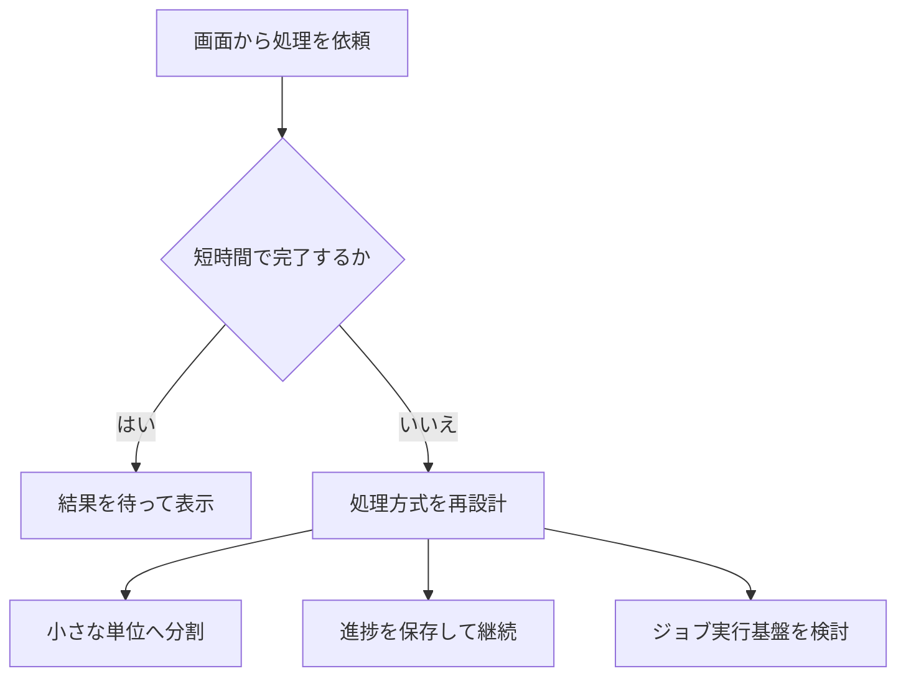
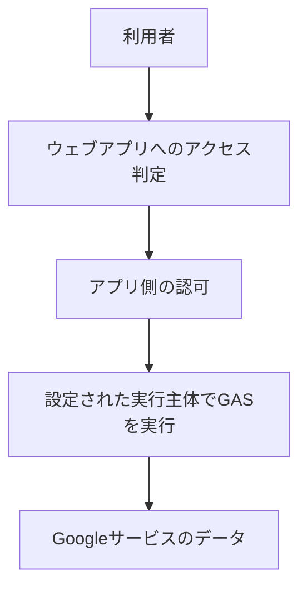
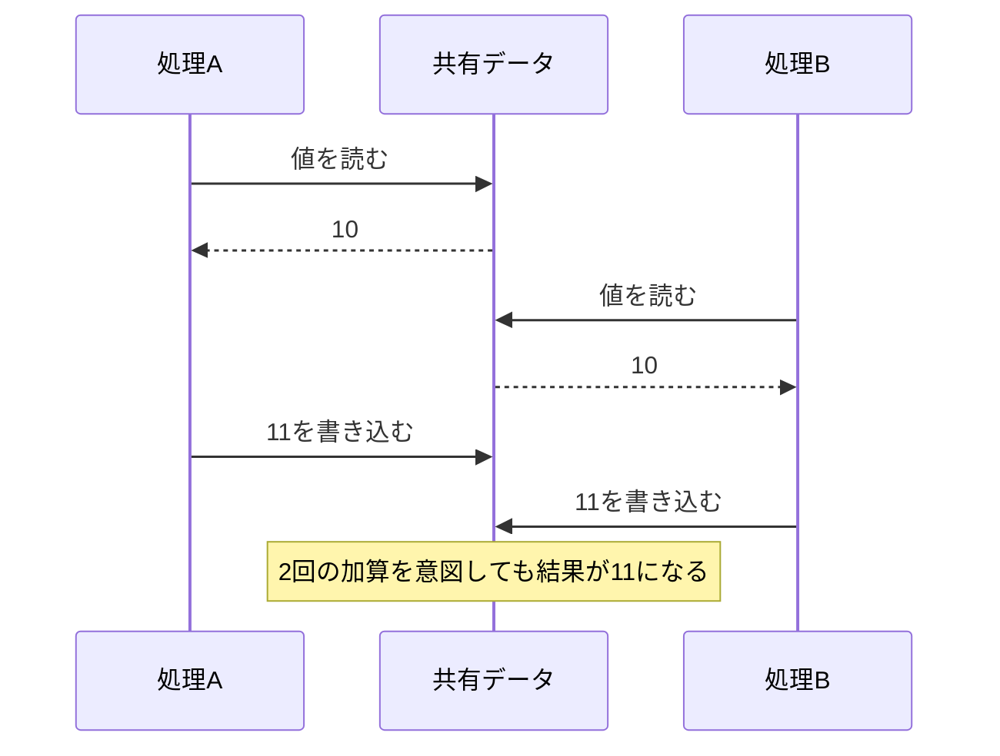
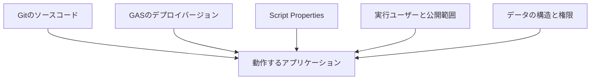

# 105. GASの制約と注意点

## この章の目的

GASの制約を確認し，アプリケーションの要件に適した使い方を検討します。

GASを採用できるかどうかは，画面を作れるかだけでは決まりません。実行時間，同時実行，データ量，アクセス権，運用体制も含めて判断します。

この章では，次を扱います。

- 実行時間と割り当て
- HTMLサービスとiframeの制約
- ローカル開発と本番環境の違い
- 実行ユーザーとアクセス制御
- スプレッドシートをデータ基盤にする際の注意
- 同時更新と再試行
- デプロイと運用上の管理
- 別の基盤を検討する判断材料

この章では，アプリケーションのソース変更は行いません。

## 1. 制約を分けて考える

「GASの制約」と呼ばれるものには，性質の異なるものがあります。

| 分類                   | 例                                            |
|------------------------|-----------------------------------------------|
| プラットフォームの上限 | 実行時間，同時実行数，サービスごとの割り当て  |
| 実行環境の特徴         | iframe，GAS固有API，サーバー側の実行権限      |
| 利用サービスの特性     | スプレッドシートのデータ構造，APIごとの制限   |
| アプリケーション設計   | 全件取得，認可不足，二重送信，過剰な通信      |
| 本ドキュメントの簡略化 | 最大100行，読み取り専用，利用者別認可の未実装 |

設計の問題と，変更できない上限を混同しないようにします。

たとえば，前章の「最大100行」は学習用APIが設けた上限であり，GASやスプレッドシート全体の最大行数ではありません。

## 2. 実行時間と割り当て

### 2.1 主な上限

次は，公式の割り当て一覧で確認した代表例です。

確認日：2026年11月18日

| 項目                     | 個人向けアカウント | Google Workspaceアカウント |
|--------------------------|--------------------|----------------------------|
| 通常のスクリプト実行時間 | 1実行あたり6分     | 1実行あたり6分             |
| ユーザー単位の同時実行   | 30                 | 30                         |
| スクリプト単位の同時実行 | 1,000              | 1,000                      |
| URL Fetchの呼び出し      | 1日20,000回        | 1日100,000回               |
| Propertiesの合計保存容量 | 1ストアあたり500KB | 1ストアあたり500KB         |

これらは公式資料上の数値を確認したものであり，本ドキュメントの負荷試験結果ではありません。

上限は予告なく変更される可能性があります。採用時と本番運用前に，必ず公式の割り当て一覧を確認してください。

カスタム関数やアドオンなどは，通常のスクリプトとは異なる実行時間の上限があります。

### 2.2 同時実行数は利用可能人数ではない

「ユーザー単位で30実行」という数値は，登録できる利用者数や，同時に画面を開ける人数を示すものではありません。

同時に動いているサーバー処理の数に関する上限です。

処理時間が長く，1画面から複数の処理を並行実行するほど，同時実行枠を消費しやすくなります。

### 2.3 アカウント種別だけでなく実行主体を確認する

割り当てはユーザー単位やスクリプト単位などで適用されます。

ウェブアプリを誰の権限で実行するかによって，負荷や権限を考える際の実行主体も変わります。

アカウント種別だけを見て，アプリ全体で使える容量を単純計算しないでください。

また，GAS側の割り当てに加え，利用するGoogleサービス側の制限が関係する場合があります。

### 2.4 長時間処理を画面から待ち続けない

次のような処理は，一度の画面操作で完了させる構成に無理がないか検討します。

- 大量行の読み取りと更新
- 多数のファイル変換
- 大量の外部API呼び出し
- 長時間の集計
- 大量メールの送信



処理を分割しても，日次割り当てなどの制約が消えるわけではありません。

## 3. 通信回数と応答時間

`google.script.run` は非同期APIです。複数の呼び出しが，記述した順序どおりに完了するとは限りません。

次を意識して設計します。

- セル単位・項目単位の過剰な呼び出しを避ける。
- 必要なデータを適切な単位でまとめる。
- 検索入力のたびに無制限にサーバーを呼ばない。
- 古い検索結果で新しい表示を上書きしない。
- 読み込み中と失敗を画面へ表示する。
- キャッシュを使う場合は鮮度と利用者間の分離を決める。

ReactやTailwind CSSを導入しても，GAS側やGoogleサービス側の処理時間そのものが短縮されるとは限りません。

### 3.1 待機の打ち切りと処理中断は別

ブラウザ側でタイムアウト表示に切り替えても，GAS側の処理が停止したとは限りません。

利用者が再試行したときに，前の書き込みが後から完了する可能性も考えます。

読み取りと書き込みで，再試行の方針を分けてください。

## 4. HTMLサービスとiframe

GASのHTMLサービスは，iframeのサンドボックス内で画面を実行します。

通常の独立したWebサイトと同じ前提で，外側のページを操作できるとは限りません。

| 項目                     | 注意点                                         |
|--------------------------|------------------------------------------------|
| 外側のページへの移動     | サンドボックスとユーザー操作の条件を確認する   |
| 外部スクリプト・スタイル | HTTPSで読み込む                                |
| URLの履歴                | iframe内と外側のページを区別する               |
| ブラウザ機能             | オリジン，権限，埋め込み条件を実環境で確認する |
| 画面共有用URL            | 内部ルートが外側のURLへ反映されるとは限らない  |

### 4.1 アプリ内遷移と外部リンクを分ける

React Routerによるアプリ内の移動と，別のWebサイトへの移動を分けます。

外部サイトを新しいタブで開く例：

```tsx
<a
  href="[https://developers.google.com/apps-script/](https://developers.google.com/apps-script/)"
  target="_blank"
  rel="noopener noreferrer"
>
  Apps Scriptの公式資料
</a>
```

`<base target="_top">` を無条件に追加すると，アプリ内リンクの動作にも影響する可能性があります。SPAでは，内部遷移と外部移動を個別に確認してください。

### 4.2 HashRouterは外側のURL同期を保証しない

前章のHashRouterは，アプリが動作するwindowのハッシュを管理します。

GASの `/exec` URLへハッシュを付ければ，必ずその画面へ直接移動できるという意味ではありません。

ブックマーク，URL共有，再読み込み後の復帰が要件にある場合は，外側のURLと内部ルートの同期も設計します。

### 4.3 単一HTMLにも確認が必要

vite-plugin-singlefileを使うことで，JavaScriptとCSSをHTMLへまとめる構成にできます。

ただし，次が自動的に解決するわけではありません。

- すべての画像やフォントの埋め込み
- 外部リソースの可用性
- 大きなHTMLの読み込み時間
- GASのiframe制約
- 外部サービスの認証

生成物の大きさと参照先を確認してください。

## 5. ローカルとGASの実行環境

GASのサーバー側は，ローカルのNode.jsサーバーではありません。

| 項目                 | ローカル開発                     | GAS                      |
|----------------------|----------------------------------|--------------------------|
| Reactの画面          | Viteで確認する                   | HTMLサービスで確認する   |
| GAS固有API           | 通常は存在しない                 | GAS側で利用する          |
| Node.js固有API       | ビルド用スクリプトなどで使用する | 同じようには使用できない |
| Googleサービスの権限 | モックでは確認できない           | 実行主体の権限で確認する |
| デプロイ設定         | 再現しない                       | 別途確認する             |

npmパッケージを導入できることと，そのパッケージがGASのサーバー側で動くことは別です。

Node.js固有API，ブラウザAPI，GAS固有APIのどれに依存しているかを確認します。

### 5.1 モックの限界

モックでは，画面の状態と表示を確認できます。

一方，次は実際のGAS環境で確認する必要があります。

- Googleへの承認
- 対象データへのアクセス権
- APIの実際の応答形式
- 実データ量での処理時間
- 割り当ての消費
- 複数利用者や同時更新の影響

モックだけで運用可能と判断しないでください。

## 6. 認証・認可・実行ユーザー

次の3つを区別します。

| 用語         | 確認する内容                                  |
|--------------|-----------------------------------------------|
| 認証         | 誰が利用しているか                            |
| 認可         | その利用者が何をしてよいか                    |
| 実行ユーザー | GASが誰の権限でGoogleサービスへアクセスするか |



ウェブアプリへアクセスできることと，すべての業務データを閲覧・更新してよいことは同じではありません。

### 6.1 自分として実行する場合

サーバー処理は，デプロイしたユーザーの権限で動きます。

便利である一方，ブラウザから任意のファイルIDや検索条件を受け取り，そのまま処理すると，想定外のデータを返す危険があります。

次をサーバー側で確認します。

- 操作を許可しているか。
- 対象データが許可範囲内か。
- 入力値が正しいか。
- 返す項目が必要最小限か。

### 6.2 利用者のメールアドレスを常に取得できるとは限らない

利用者を識別するAPIの結果は，実行方法や権限，組織の条件などに影響されます。

メールアドレスが常に取得できる前提で認可を実装しないでください。必要な環境で取得条件を検証し，識別できない場合は安全側で拒否する設計を検討します。

### 6.3 画面の非表示は認可ではない

管理者用ボタンを非表示にしただけでは，サーバー処理の保護にはなりません。

ブラウザからの入力や呼び出しは，改変され得るものとして扱います。

## 7. スプレッドシートをデータ基盤にする注意点

スプレッドシートは，表形式でデータを確認・編集しやすい一方，アプリケーションの整合性を自動的に保証するものではありません。

| 論点     | 検討する内容                         |
|----------|--------------------------------------|
| 識別子   | 行番号ではなく，不変のIDを持つ       |
| 型       | 日付，数値，空欄，文字列を区別する   |
| 手動編集 | 列変更，行削除，重複入力に対応する   |
| 参照関係 | 別シートのIDとの整合性を確認する     |
| データ量 | 全件読み取りの時間と返却量を確認する |
| 更新     | 同時編集と途中失敗を考慮する         |
| 復旧     | 誤更新時に戻せる範囲と手順を決める   |

特に，行番号を業務上の識別子として使用すると，並べ替えや行削除で対象が変わる危険があります。

業務要件として複雑なトランザクション，厳密な制約，高頻度の同時更新が必要な場合は，データベースの採用を検討します。

## 8. 同時更新と二重実行

複数の処理が，同じ値を読み取ってから更新すると，後から行った書き込みが前の変更を上書きする可能性があります。



### 8.1 LockServiceの役割と限界

LockServiceは，同時実行による競合を避けるための仕組みです。

本ドキュメントのようなスタンドアロンのウェブアプリでは，共有処理の排他に `getScriptLock()` を検討します。

`getDocumentLock()` は，スタンドアロンスクリプトやウェブアプリではnullになるため，同じ前提で使用できません。

また，ロックは取得メソッドを呼ぶだけでは獲得されません。`tryLock()` や `waitLock()` が必要です。

ただし，ロックには次の限界があります。

- 同じロックを使わない別処理は保護されない。
- スプレッドシートの手動編集は防げない。
- 別プロジェクトからの書き込みを自動的に統制しない。
- 複数サービスにまたがる更新を自動的に取り消さない。
- 長いロック待ちは応答時間と実行時間を消費する。

### 8.2 二重送信は別に対策する

ボタンの無効化だけでは，二重実行を完全には防げません。

書き込み処理では，必要に応じて次を設計します。

- リクエストIDによる重複検知
- 更新済みかどうかの確認
- バージョン番号による競合検知
- 再試行しても結果が重複しない操作
- 部分成功時の補償処理

前章の読み取り専用サンプルには，これらの書き込み対策は含めていません。

## 9. デプロイと構成管理

コード以外にも，動作を左右する設定があります。



### 9.1 pushだけでは公開バージョンが変わらない

`clasp push` によるコードの反映と，バージョン付きデプロイの更新は別です。

更新時には，次を対応付けて記録します。

- Gitのコミット
- GASのバージョン
- デプロイID
- 設定変更
- データ構造の変更

### 9.2 設定やデータはコードと別に変化する

Script Propertiesやスプレッドシートは，コードのデプロイバージョンとは別に変更されます。

以前のコードへ戻しても，当時の設定やデータに自動復旧するわけではありません。

設定変更の記録，バックアップ，後方互換性を検討します。

### 9.3 開発用と本番用を分ける

運用する段階では，少なくとも次を分ける方針を検討します。

- GASプロジェクト
- データの保存先
- 接続設定
- アクセス権
- デプロイ手順

テスト操作で本番データを更新しない構成にします。

## 10. 監視と障害調査

GASの実行履歴やログを使い，次を追えるようにします。

- どの処理で失敗したか。
- いつ，どのバージョンで発生したか。
- 権限，設定，入力，割り当てのどれに関係するか。
- 一時的な失敗か，継続的な問題か。

ログへ個人情報や秘密情報を出しすぎないことも重要です。

前章のサンプルは，内部情報の露出を避けるためログを最小限にしています。運用向けには，エラーコードや相関IDなどを追加して調査可能性を高めます。

GASを使うことで，監視，問い合わせ対応，バックアップ，権限管理が不要になるわけではありません。

## 11. 採用判断の考え方

### 11.1 GASを候補にしやすい条件

次のような条件では，GASを候補として検討できます。

- Google Workspaceとの連携が中心である。
- 利用者と公開範囲を明確にできる。
- 1回の処理を短く保てる。
- データ量と更新頻度が限定的である。
- 組織の管理方針と運用体制に合っている。

これらを満たせば必ず適合するという意味ではありません。代表的な処理を実装して確認します。

### 11.2 別の基盤を検討する条件

| 要件                         | 検討する方向                         |
|------------------------------|--------------------------------------|
| 長時間・大量のジョブ         | ジョブ実行基盤やキュー               |
| 高頻度の同時更新             | トランザクションを扱うデータベース   |
| 複雑な利用者・組織別権限     | 専用の認証・認可を備えたバックエンド |
| 独自ドメインや配信制御が重要 | 独立したフロントエンド配信基盤       |
| iframeとの相性が悪い機能     | 通常のWebアプリケーション構成        |
| 厳格な運用・監査要件         | 監視・権限・変更管理を含む基盤選定   |

一部だけを別基盤へ移す構成も選択肢です。

ただし，フロントエンドを別サイトへ移す場合は，`google.script.run` をそのまま移植できません。認証と通信方式を改めて設計します。

## 12. 本番運用前の確認

- [ ] 利用者と公開範囲を定義した。
- [ ] 実行主体と認可方式を確認した。
- [ ] 最新の割り当てを確認した。
- [ ] 実データに近い量で処理時間を測定した。
- [ ] 想定する同時実行を確認した。
- [ ] iframe上の表示とブラウザ機能を確認した。
- [ ] モックだけでなくGAS上でも確認した。
- [ ] 入力とレスポンスを検証している。
- [ ] 必要に応じて同時更新対策を設計した。
- [ ] 二重送信と再試行の方針を決めた。
- [ ] 開発環境と本番環境を分離した。
- [ ] コードと設定の変更を記録できる。
- [ ] 障害調査と問い合わせの手順を決めた。
- [ ] コードとデータの復旧方法を分けて確認した。
- [ ] GASで満たせない要件の代替案を検討した。

次の章では，これらの制約を踏まえ，責務を分離したアプリケーション構成を検討します。

## 参考資料

- [GASの割り当てと上限](https://developers.google.com/apps-script/guides/services/quotas)
- [HTMLサービスの制限](https://developers.google.com/apps-script/guides/html/restrictions)
- [HTMLサービス：サーバー関数との通信](https://developers.google.com/apps-script/guides/html/communication)
- [GASのウェブアプリ](https://developers.google.com/apps-script/guides/web)
- [Session](https://developers.google.com/apps-script/reference/base/session)
- [LockService](https://developers.google.com/apps-script/reference/lock/lock-service)
- [GASのベストプラクティス](https://developers.google.com/apps-script/guides/support/best-practices)
- [デプロイの作成と管理](https://developers.google.com/apps-script/concepts/deployments)
- [GASのログ](https://developers.google.com/apps-script/guides/logging)

---

[前の章：Googleサービスとの連携](104-use-google-services.md) | [目次へ戻る](../../README.md) | [次の章：GASアプリケーションのアーキテクチャ](106-gas-architecture.md)
