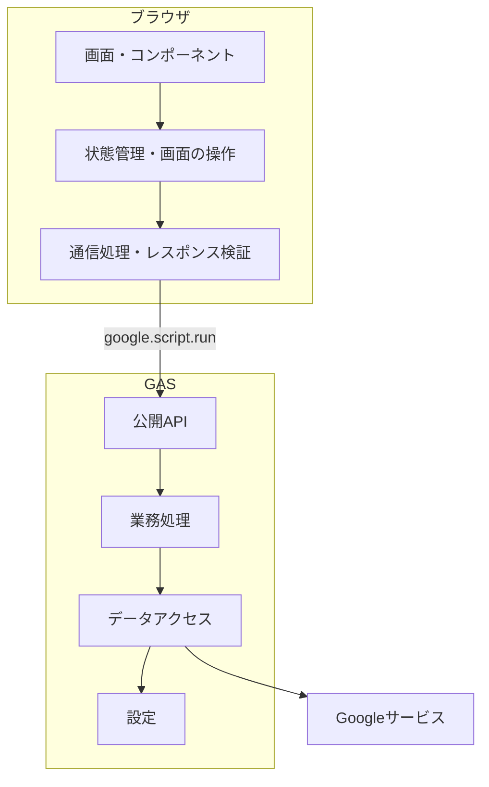
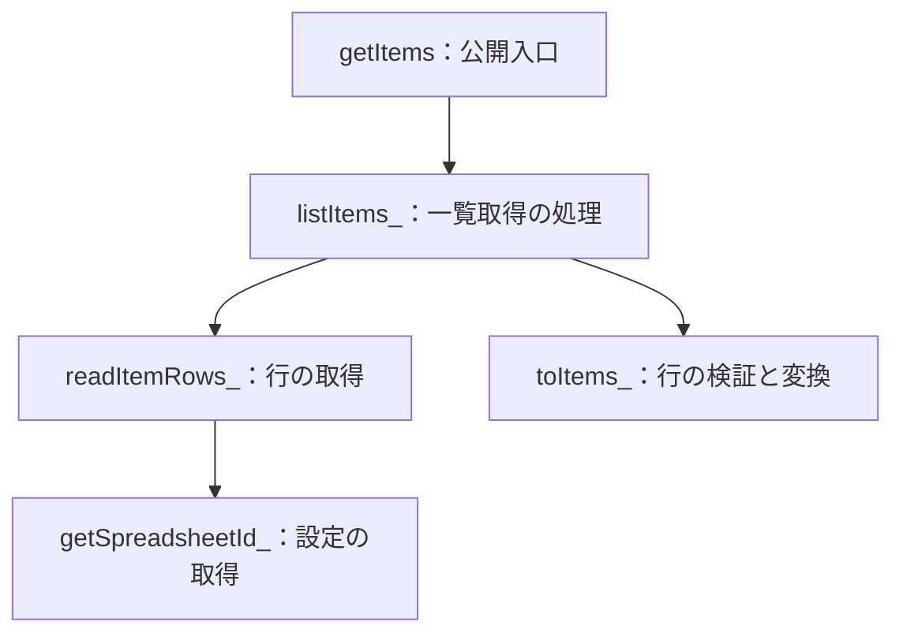
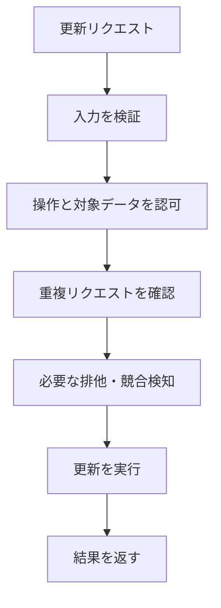
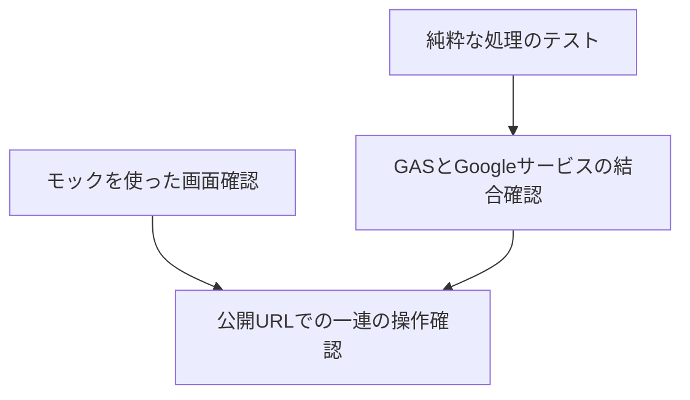
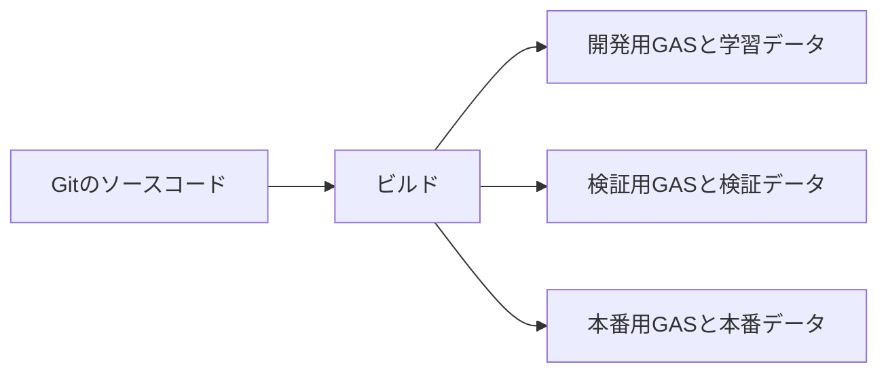

# 106. GASアプリケーションのアーキテクチャ

## この章の目的

これまでに作成したアプリケーションを振り返り，機能追加と保守を続けやすい構成を検討します。

この章では，次を整理します。

- フロントエンドとGASの責務
- 通信境界とデータ形式
- 公開APIと内部処理の分離
- 業務処理とデータアクセスの分離
- 設定，ログ，エラーの扱い
- ビルドと配置対象の管理
- テストと運用の考え方
- アプリケーションの規模に応じた設計

本章は設計ガイドです。掲載する構成案や抜粋コードは，既存サンプルへ必ず適用する変更手順ではありません。

基本編から前章までのアプリケーションは，そのまま動作確認を続けられます。

## 1. 設計の基本方針

次の方針を出発点にします。

1. 画面からGoogleサービスの詳細を切り離す。
2. 通信境界では入力と出力の形式を明確にする。
3. 権限判定と入力検証をサーバー側で実施する。
4. 業務上の判断とデータの読み書きを分ける。
5. ソースコードと生成物を区別する。
6. エラーと復旧方法を設計する。
7. 小規模な段階では，必要以上に抽象化しない。

ファイルを増やすこと自体が目的ではありません。

「変更するときに，どこを確認すればよいか」が分かる構成を目指します。

## 2. 全体を層に分ける



これは論理的な責務の分離です。

それぞれを別のサーバーや別のGASプロジェクトに分割するという意味ではありません。

小規模な段階では，同じファイル内の関数として分ける方法でも構いません。

## 3. フロントエンドの責務

### 3.1 画面

画面は，次を担当します。

- データの表示
- 入力操作
- 読み込み中や失敗の表示
- 利用者に分かる説明
- キーボード操作や読み上げへの配慮

画面コンポーネントへ，スプレッドシートの列番号やScript Propertiesのキーを直接持ち込まない方針にします。

### 3.2 状態管理

状態を次のように分けます。

| 状態 | 例 | 主な保持場所 |
|---|---|---|
| 部品内の状態 | 入力中の値，開閉状態 | 必要とするコンポーネント |
| 画面をまたぐ状態 | 複数画面で共有する条件 | 共通の親や状態管理層 |
| サーバー由来の状態 | 一覧，取得結果，取得状況 | 機能単位のフックなど |
| 永続化するデータ | 保存済みの業務データ | GASの先にある保存先 |

Reactの状態を，永続的な保存先と混同しないようにします。

### 3.3 通信処理

通信処理は，次を担当します。

- GASの呼び出し
- コールバックからPromiseへの変換
- レスポンスの検証
- 通信エラーの整理
- ローカル用実装との切り替え

画面の各所へ `google.script.run` を直接記述しないことで，モックと実通信の切り替え箇所を限定します。

## 4. GAS側の責務

### 4.1 公開API

公開APIは，ブラウザから呼び出す入口です。

主な責務は次のとおりです。

- 入力形式の検証
- 必要な認証・認可の確認
- 業務処理の呼び出し
- 返却データの整形
- エラーの記録と利用者向けメッセージへの変換

認可は入口だけに書けば常に十分という意味ではありません。対象データごとの判定が必要な場合は，業務処理にも必要な文脈を渡します。

### 4.2 業務処理

業務処理は，アプリケーション固有の判断を担当します。

例：

- 一覧へ含める条件
- 状態の変更可否
- 必須項目や値の組み合わせ
- 更新の順序
- 重複や競合の扱い

セルの取得方法よりも，業務上何を成立させるかに集中させます。

### 4.3 データアクセス

データアクセスは，保存先とのやり取りを担当します。

例：

- スプレッドシートを開く。
- シートや列を特定する。
- 行を読み取る。
- 行データをアプリケーションの形式へ変換する。
- 必要な範囲を書き込む。

Googleサービスへの呼び出しは，可能な範囲でまとめます。

セルごとに読み書きを繰り返すより，範囲を配列として取得し，メモリ上で処理してから必要な範囲へ書き戻す構成を検討します。

ただし，件数が大きい場合に無制限の全件取得を行うという意味ではありません。

## 5. 公開APIと内部関数を分ける

GASでは，名前が `_` で終わるサーバー関数は，`google.script.run` から直接呼び出せません。

命名の例：

```js
function getItems() {
  // ブラウザから呼び出す入口
}

function listItems_() {
  // 内部処理
}

function readItemRows_() {
  // 内部のデータアクセス
}
```

公開する入口を絞り，内部実装には末尾の `_` を使用する方針を検討します。

ただし，これは利用者の認可を代替するものではありません。公開APIから内部関数を呼べるため，入口の権限判定や対象データの制限は別に必要です。

### 5.1 通常のJavaScriptファイル分割との違い

GAS側のファイルを分けても，通常のES Modulesのようにファイル単位のスコープが自動的にできるわけではありません。

本ドキュメントのGAS側は，import/exportを使ったサーバーバンドルを導入していません。

次を守ります。

- グローバル名の衝突を避ける。
- ファイルの評価順序に依存する初期化を減らす。
- Googleサービスへのアクセスを関数実行時に行う。
- ファイル分割を権限境界と考えない。

## 6. データ形式を境界で変換する

フロントエンドが受け取る形式と，シート内部の構成を分けます。


たとえば，シートが次の列を持っていても，

```text
A列：ID
B列：表示名
C列：内部メモ
D列：更新日時
```

画面へ必要なのがIDと表示名だけなら，次だけを返します。

```ts
type Item = {
  id: string;
  name: string;
};
```

このような受け渡し用のデータ形式を，DTOと呼ぶことがあります。

### 6.1 列順を画面へ漏らさない

画面側で `row[1]` を表示する構成より，`item.name` を使用する構成にします。

列の変更時に，画面全体を修正する必要がないようにするためです。

### 6.2 通信できる型を使用する

`google.script.run` の受け渡しに適した値を使用します。

- 文字列
- 数値
- 真偽値
- null
- それらで構成した配列やオブジェクト

Dateなどは，必要な形式の文字列へ変換します。

TypeScriptの型宣言と，実行時の入力・出力検証は別です。ブラウザから届く値も，サーバーから届く値も，境界で検証します。

## 7. 既存の一覧処理を整理する例

前章の `getItems()` は，小さな学習用APIとして1つの関数にまとめています。

規模が増えた場合は，次の責務へ分けることを検討します。



以下は，依存関係の考え方だけを示す抜粋です。これだけで置き換えられる完成コードではありません。

```js
function listItemsWith_(readRows, convertRows) {
  const rows = readRows();
  return convertRows(rows);
}
```

依存する処理を関数として受け取ることで，業務処理を確認するときに，実際のスプレッドシートを開かずにテストデータを渡せます。

一方，この程度の処理に抽象化の効果があるかどうかも検討します。小さな関数を増やすだけで読みにくくなる場合は，先に責務の説明を整理してください。

## 8. ディレクトリ構成の発展例

機能が増えた場合の構成案です。

```text
gas-react-app/
├── src/
│   ├── components/
│   ├── layouts/
│   ├── pages/
│   ├── features/
│   │   ├── counter/
│   │   └── items/
│   │       ├── api/
│   │       ├── components/
│   │       ├── hooks/
│   │       └── types/
│   ├── App.tsx
│   └── main.tsx
│
├── gas/
│   ├── Code.js
│   ├── ItemsApi.js
│   ├── ItemsService.js
│   ├── ItemsRepository.js
│   ├── Config.js
│   └── appsscript.json
│
├── scripts/
│   └── prepare-gas.mjs
│
├── dist/
├── build/
│   └── gas/
├── .clasp.json
├── .clasp.json.example
├── .claspignore
├── .gitignore
└── package.json
```

これは発展例であり，現在のサンプルの実ファイル構成とは異なります。

### 8.1 配置準備も変更する必要がある

基本編の `prepare-gas.mjs` は，次の3ファイルを扱う固定構成です。

- `index.html`
- `Code.js`
- `appsscript.json`

`.claspignore` も同じ3ファイルに限定しています。

GAS側のファイルを追加する場合は，次をまとめて更新してください。

1. ソースファイルを分割する。
2. 配置準備スクリプトの許可リストを更新する。
3. `.claspignore` の許可対象を更新する。
4. 古い配置ファイルの扱いを確認する。
5. ビルド後の出力を確認する。
6. `clasp show-file-status` で送信対象を確認する。
7. 開発用GASプロジェクトで動作確認する。

構成図だけ変更して，配置スクリプトをそのままにしないでください。

### 8.2 フロントエンドの分割はビルドでまとめる

Reactのソースを細かく分割しても，既存のViteとsinglefileの設定で配信用HTMLへまとめます。

フロントエンドのファイル数と，GASへ送るファイル数を同じにする必要はありません。

## 9. 設定と秘密情報を分ける

| 設定 | 主な配置場所 | 注意点 |
|---|---|---|
| 画面の公開設定値 | フロントエンドの設定 | 配信後に参照され得る |
| GASの接続先 | ローカルの `.clasp.json` | 環境ごとに分ける |
| サーバー側の環境設定 | Script Propertiesなど | 編集者と管理方法を確認する |
| 認証トークン | 認証ツールや適切な保管先 | Gitへ追加しない |
| デプロイの公開範囲 | GASのデプロイ設定 | コードとは別に確認する |

Viteの `VITE_` 接頭辞を付けた変数は，フロントエンドへ公開する値として扱います。

`.env` をGitから除外していても，ビルド結果へ値を含めれば秘密情報の保護にはなりません。

また，Script Propertiesへ保存したことだけで，厳格な秘密情報管理が完成するわけではありません。

## 10. エラーとログの設計

エラーを，利用者向けと開発者向けに分けます。

| 対象 | 必要な情報 |
|---|---|
| 利用者 | 何ができなかったか，次に何をすればよいか |
| 開発者 | どの処理で，どの分類の問題が起きたか |
| 運用担当者 | 影響範囲，発生日時，対象バージョン，復旧方法 |

### 10.1 返却方式を揃える

次のどちらかを，API全体で一貫して扱う方針にします。

- 失敗を例外にして，failure handlerで受ける。
- 成功と失敗を識別できるレスポンス形式で返す。

前章のサンプルは，例外とfailure handlerを使用しています。

返却形式を変更する場合は，GAS側だけでなく，通信処理，実行時検証，モック，画面表示も合わせて変更します。

### 10.2 内部情報をそのまま返さない

セルの内容，個人情報，トークン，スタックトレースを，そのまま画面へ返さないようにします。

一方，ログを削りすぎて調査不能にならないように，エラーコードや相関IDの利用も検討します。

## 11. 書き込みを追加する際の設計

一覧取得ができても，そのまま同じ構成で安全な更新ができるとは限りません。



この図の処理順序は概念的なものです。

重複確認と更新の間に競合が起きないよう，実装ではロックや保存先の制約を含めて，原子的に扱う範囲を決めます。

検討する項目：

- IDの検証
- 更新可能な状態の確認
- リクエストの重複検知
- バージョン番号などによる競合検知
- 必要な範囲へのLockServiceの適用
- 部分成功と再試行
- 操作履歴
- データ復旧

前章の読み取り専用サンプルには，これらを追加していません。

## 12. テストを層ごとに分ける



| 対象 | 確認する内容 |
|---|---|
| 入力・出力の変換 | 必須項目，型，空データ，不正値 |
| 業務処理 | 条件分岐，状態遷移，重複，競合 |
| 画面 | 読み込み中，成功，空，失敗，操作 |
| データアクセス | シート名，列構成，権限，実データ量 |
| デプロイ済みアプリ | 公開範囲，承認，画面遷移，更新反映 |

本ドキュメントでは，自動テスト用の実行基盤はまだ導入していません。

テストを自動化する場合は，純粋な処理，ブラウザ依存の処理，GAS依存の処理を分けて，実行環境を決めます。

## 13. 開発・検証・本番を分ける

運用段階では，次の組み合わせを環境ごとに管理します。



同じソースからビルドしても，次は別管理です。

- 接続先スクリプトID
- Script Properties
- データの保存先と権限
- デプロイの実行ユーザー
- アクセス範囲

単にローカルの環境変数名を切り替えるだけで，GAS側の全設定が切り替わるとは考えないでください。

反映直前に接続先と送信対象を確認する手順を維持します。

## 14. 規模に応じて構成を選ぶ

| 状況 | 構成の考え方 |
|---|---|
| 最小サンプル | 少数のファイルと明確な関数分割 |
| 機能が増える | 機能単位のフロントエンドとGAS側の責務分離 |
| 複数人で開発 | API契約，設定管理，レビュー，テストを整備 |
| 大量データや複雑な更新 | データベースや専用バックエンドを検討 |
| 長時間処理 | ジョブ実行基盤やキューを検討 |

共通化は，実際の重複や変更理由を確認してから行います。

最初から汎用API呼び出し基盤，巨大な共通コンポーネント，複雑な依存性注入の仕組みを作る必要はありません。

一方，小規模だからといって，認可や秘密情報の管理を省略してよいわけでもありません。

## 15. 設計レビューの確認項目

### フロントエンド

- [ ] 画面と通信処理が分かれている。
- [ ] 状態を保持する場所が明確である。
- [ ] 計算できる値を重複して状態保存していない。
- [ ] 読み込み中・空・失敗を表示できる。
- [ ] レスポンスを実行時検証している。
- [ ] 利用者の操作とEffectの役割を分けている。

### GAS

- [ ] 公開APIを必要な範囲に限定している。
- [ ] 内部関数の呼び出し範囲を整理している。
- [ ] サーバー側で入力と権限を確認している。
- [ ] 業務処理とデータアクセスを区別している。
- [ ] サービス呼び出し回数と取得件数を制限している。
- [ ] 書き込みには競合と二重実行の対策を検討している。

### ビルドと運用

- [ ] ソースと生成物を区別している。
- [ ] ファイル分割に配置設定が追随している。
- [ ] 反映先と送信対象を確認できる。
- [ ] コードと設定とデータを別に管理している。
- [ ] エラー調査と復旧の手順がある。
- [ ] GASの制約に収まることを実環境で確認している。

## 16. 本ドキュメントのまとめ

基本編では，プロジェクトの作成からローカル確認，ビルド，GASへの反映とデプロイまでを扱いました。

応用編では，スタイリング，コンポーネント分割，画面遷移，Googleサービスとの連携，制約と設計を扱いました。

今後機能を追加するときも，次の対応関係を維持します。

- 画面で何を表示し，何を操作するか。
- どのAPIを呼び出すか。
- サーバー側で何を検証し，許可するか。
- どのデータを読み書きするか。
- 失敗時にどう表示し，調査し，復旧するか。

使用技術を並べるだけでなく，それぞれの責務と境界を明確にすることを，設計と保守の軸にします。

## 参考資料

- [GASのベストプラクティス](https://developers.google.com/apps-script/guides/support/best-practices)
- [HTMLサービス：サーバー関数との通信](https://developers.google.com/apps-script/guides/html/communication)
- [Properties Service](https://developers.google.com/apps-script/guides/properties)
- [LockService](https://developers.google.com/apps-script/reference/lock/lock-service)
- [GASのログ](https://developers.google.com/apps-script/guides/logging)
- [コンポーネント間で状態を共有する](https://react.dev/learn/sharing-state-between-components)
- [カスタムフックでロジックを再利用する](https://react.dev/learn/reusing-logic-with-custom-hooks)

---

[前の章：GASの制約と注意点](105-disadvantage-of-gas.md) | [目次へ戻る](../../README.md)
