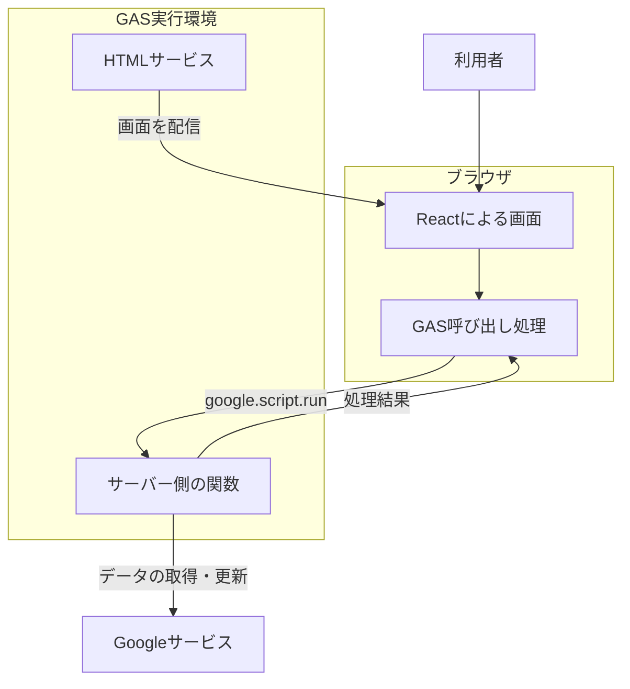
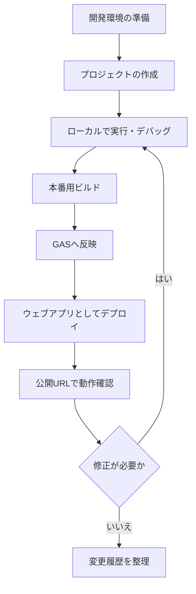
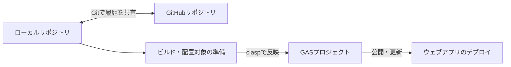

# 001. 全体像

## この章の目的

本ドキュメントでは，React・TypeScriptを使用して画面を開発し，Google Apps Script（以下，GAS）のウェブアプリとして公開する手順を説明します。

macOS・zshを開発環境とし，ローカルでの開発，動作確認，ビルド，GASへの反映，公開後の更新までを扱います。

この章では，次の内容を確認します。

- 本ドキュメントの対象読者と扱う範囲
- 使用する技術とそれぞれの役割
- ローカル環境とGAS実行環境の関係
- 開発から公開までの流れ
- 基本編と応用編の読み進め方

## 1. 対象読者

次のような方を対象にしています。

- GASのコードをローカル環境で管理したい方
- HTML・CSS・JavaScriptによる画面を，Reactを使って開発したい方
- TypeScriptを使用してフロントエンドを開発したい方
- GASとGoogleサービスを連携させたアプリケーションを作りたい方
- Gitによる変更管理を取り入れたい方

HTML・CSS・JavaScriptの基本的な知識を前提に説明します。

React・TypeScriptについては，本ドキュメントで使用する範囲を説明しますが，文法や機能を網羅するものではありません。

## 2. 完成時に目指す状態

基本編では，最小構成のアプリケーションについて，次の状態を目指します。

1. ローカル環境でプロジェクトを作成できる。
2. ブラウザで画面を表示し，ローカルで動作を確認できる。
3. GASに配置するためのHTMLをビルドできる。
4. claspを使用して必要なファイルをGASへ反映できる。
5. ウェブアプリとして公開し，公開URLで画面を確認できる。
6. 修正後のビルド・反映・公開更新を実施できる。
7. ソースコードと設定をGitで管理できる。

応用編では，スタイリング，コンポーネント設計，複数画面，Googleサービスとの連携を扱います。さらに，GASの制約と，保守しやすい構成について検討します。

## 3. 使用する技術

| 技術 | 本ドキュメントでの役割 |
|---|---|
| React | コンポーネントを組み合わせて画面を構築する |
| TypeScript | 型を使用してフロントエンドのコードを記述する |
| Vite | ローカル開発用サーバーと本番用ビルドを担当する |
| Tailwind CSS | ユーティリティクラスを使用して画面を装飾する |
| vite-plugin-singlefile | ビルド時にJavaScript・CSSをHTML内へまとめる |
| React Router | Hash方式による画面遷移を実装する |
| GAS | HTMLの配信とGoogleサービスを利用するサーバー処理を担当する |
| clasp | ローカルファイルとGASプロジェクトの連携・管理に使用する |
| Git | ソースコードとドキュメントの変更履歴を管理する |

Tailwind CSSとReact Routerの具体的な使用方法は，応用編で説明します。

vite-plugin-singlefileを使用しても，任意の外部リソースがすべて自動的にHTMLへ埋め込まれるとは限りません。画像・フォント・外部URLなどの扱いは，ビルド結果と実際の表示を確認します。

## 4. アプリケーションの全体構成

アプリケーションを，次の3つに分けて考えます。

- ブラウザで実行するフロントエンド
- Google側で実行するGASのサーバー処理
- GASから利用するGoogleサービス

### 4.1 フロントエンド

画面の表示，入力操作，画面内の状態管理などを担当します。

React・TypeScriptで記述したコードをビルドし，ブラウザで実行するHTML・JavaScript・CSSとして使用します。

TypeScriptのソースコードを，そのままブラウザやGASで実行する構成ではありません。

### 4.2 GASのサーバー処理

HTMLサービスを使用して画面を配信し，必要に応じてGoogleサービスを利用する処理を実行します。

ウェブアプリの画面配信では，`doGet()` から `HtmlOutput` を返す構成を使用します。

フロントエンドからサーバー側の関数を呼び出す場合は，`google.script.run` を使用します。

この呼び出しは非同期であるため，処理中の表示，成功時の処理，失敗時の処理を分けて設計します。

### 4.3 Googleサービス

スプレッドシートやGoogleドライブなど，アプリケーションに必要なサービスをGASから利用します。

利用するサービスやデータによって，権限の承認や設定が必要です。具体的な連携方法は応用編で扱います。

## 5. 開発から公開までの流れ

### 5.1 ローカルで開発する

エディタでソースコードを編集し，Viteの開発用サーバーで画面を確認します。

通常のローカル開発用ページには，GASのHTMLサービスが提供する `google.script.run` はありません。そのため，GASとの通信部分はモックなどに置き換えて確認する方針とします。

モックで確認した結果だけでは，GASの実行権限や実データへのアクセスまで検証できません。GAS上での確認も実施します。

### 5.2 ビルドする

React・TypeScriptのソースコードから，配信用のファイルを生成します。

vite-plugin-singlefileを使用して，JavaScript・CSSをHTML内へまとめる構成にします。

ビルドの対象はフロントエンドです。GASのサーバー側のコードやマニフェストも含めて，GASへ反映するファイルを整理します。

### 5.3 GASへ反映する

claspを使用して，配置対象のファイルをGASプロジェクトへ反映します。

ソースコード，設定，ビルド結果のどれを送信するかを明確にし，不要なファイルを送信しない構成にします。

### 5.4 公開・更新する

GASへコードを反映する作業と，ウェブアプリのデプロイを作成・更新する作業を区別します。

公開URLでどの内容が動作しているかを確認し，コードを反映しただけで公開環境も更新されたと思い込まないようにします。

具体的な操作は「005. GASへのデプロイ」で説明します。

## 6. Gitとclaspの役割

Gitとclaspは，目的が異なります。

| ツール | 主な目的 | 管理するもの |
|---|---|---|
| Git | 変更履歴の管理 | ローカルリポジトリ内の管理対象ファイル |
| clasp | GASプロジェクトとの連携 | GASへ反映するコード・HTML・マニフェストなど |

GitHubにコードを送信する操作と，GASへコードを反映する操作は別です。

また，本ドキュメントを公開するGitHubリポジトリと，読者が作成するGASアプリケーションの公開範囲も，それぞれ別に管理します。

## 7. ドキュメント構成

### 7.1 基本編

基本編は，上から順に読み進めます。

| 章 | 内容 |
|---|---|
| [001. 全体像](001-overview.md) | 目的，技術構成，開発と公開の流れを確認する |
| [002. 開発環境の準備](002-setup.md) | 必要なツールを準備する |
| [003. プロジェクトの作成](003-create-project.md) | 最小構成のプロジェクトを作成する |
| [004. ローカルでの実行とデバッグ](004-local-debug.md) | 画面の確認と問題の調査を行う |
| [005. GASへのデプロイ](005-deploy.md) | ビルド，反映，公開，更新を行う |

### 7.2 応用編

応用編は，基本編を完了してから読み進めます。

| 章 | 内容 |
|---|---|
| [101. Tailwind CSSによるスタイリング](../advanced/101-tailwindcss.md) | 画面の見た目を整える |
| [102. React・TypeScriptによるフロントエンド開発](../advanced/102-modern-frontend.md) | コンポーネントと状態・型を整理する |
| [103. SPAと画面遷移](../advanced/103-spa-application.md) | React RouterのHash方式で複数画面を構成する |
| [104. Googleサービスとの連携](../advanced/104-use-google-services.md) | GASとの通信とGoogleサービスの利用を実装する |
| [105. GASの制約と注意点](../advanced/105-disadvantage-of-gas.md) | 制約と採用時の検討事項を確認する |
| [106. GASアプリケーションのアーキテクチャ](../advanced/106-gas-architecture.md) | 責務分離と保守しやすい構成を検討する |

## 8. 手順を進める際の注意

### 8.1 コマンドの実行場所を確認する

各手順に記載したディレクトリでコマンドを実行します。

特に，Gitリポジトリのルートと，サンプルアプリケーションのルートを混同しないようにします。

### 8.2 環境依存の値を置き換える

GASのスクリプトID，デプロイID，スプレッドシートIDなどは，自分の環境に対応する値を使用します。

説明中のプレースホルダーを，そのまま実行時の値として使用しないでください。

### 8.3 公開するファイルを確認する

GitHubへ公開する前に，認証情報，トークン，個人情報，実データが含まれていないかを確認します。

フロントエンドのビルド結果に含まれる値は，利用者から参照され得るものとして扱います。秘密情報を埋め込まないでください。

また，`git add .` を実行する前には，`git status` と差分を確認します。

### 8.4 バージョンを確認する

ツールやライブラリの更新によって，必要な設定やコマンドが変わる場合があります。

環境構築時には，使用したバージョンと実行結果を記録します。本ドキュメントの動作確認情報は，実際に確認した結果に基づいて追記します。

## 9. この章の確認

次の内容を説明できれば，次の章へ進みます。

- フロントエンドとGASのサーバー処理の役割
- ローカルでの確認とGAS上での確認の違い
- ビルド，GASへの反映，デプロイの違い
- Gitとclaspの役割の違い
- 基本編と応用編で扱う内容

## 参考資料

- [HTMLサービスの概要](https://developers.google.com/apps-script/guides/html)
- [HTMLサービス：サーバー関数との通信](https://developers.google.com/apps-script/guides/html/communication)
- [claspによるコマンドライン開発](https://developers.google.com/apps-script/guides/clasp?hl=ja)
- [vite-plugin-singlefile](https://github.com/richardtallent/vite-plugin-singlefile)

---

[目次へ戻る](../../README.md) | [次の章：開発環境の準備](002-setup.md)
