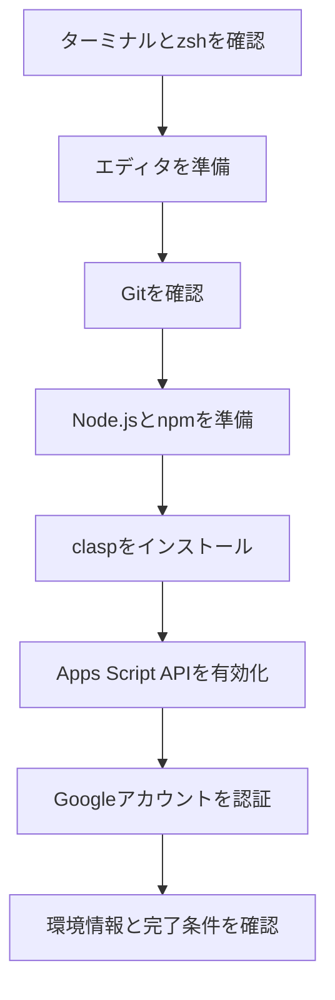
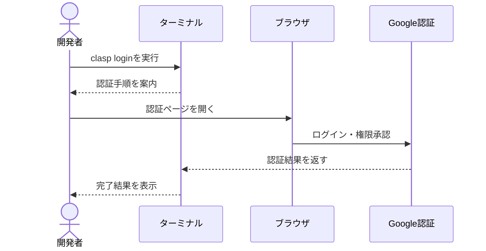

# 002. 開発環境の準備

## この章の目的

macOS上で，GASアプリケーションのローカル開発に必要な環境を準備します。

この章では，アプリケーションのプロジェクト作成やデプロイは行いません。

完了時には，次の状態を目指します。

- zshでコマンドを実行できる。
- エディタでファイルを編集できる。
- Git・Node.js・npmを実行できる。
- claspを実行できる。
- claspでGoogleアカウントの認証を完了している。
- 使用するアカウントでApps Script APIを有効にしている。

## 1. 準備するもの

| 項目             | 用途                                         |
|------------------|----------------------------------------------|
| macOS            | 開発用のOS                                   |
| ターミナルとzsh  | コマンドの実行                               |
| エディタ         | コードと設定ファイルの編集                   |
| ブラウザ         | 画面確認とGoogleへのログイン                 |
| Git              | ソースコードの変更管理                       |
| Node.js          | フロントエンドの開発ツールの実行             |
| npm              | JavaScriptパッケージの導入とスクリプトの実行 |
| clasp            | GASプロジェクトのローカル管理                |
| Googleアカウント | GASの利用と認証                              |

エディタはVisual Studio Codeを例に説明します。別のエディタを使用しても構いません。

Google Workspaceの管理対象アカウントでは，組織のポリシーによってGASや外部ツールの利用が制限される場合があります。

## 2. 作業の流れ



既に準備済みのツールは，再インストールする必要はありません。まず現在の状態を確認してください。

## 3. ターミナルとzshを確認する

macOSの「ターミナル」を起動します。

次のコマンドで，現在実行中のシェルを確認します。

```sh
ps -p $$ -o comm=
```

表示に `zsh` が含まれていることを確認します。

別のシェルを使用している場合は，次のコマンドでzshを起動できます。

```sh
zsh
```

zshのバージョンも確認します。

```sh
zsh --version
```

本ドキュメントのシェルスクリプトは，zshで実行します。

```sh
zsh gemini-scripts/スクリプト名.sh
```

または，実行権限を付けて直接実行します。

```sh
chmod +x gemini-scripts/スクリプト名.sh
./gemini-scripts/スクリプト名.sh
```

`sh スクリプト名.sh` のように実行すると，先頭の `#!/bin/zsh` ではなく，指定したシェルで処理されます。zsh用のスクリプトは `sh` では実行しないでください。

## 4. エディタを準備する

Visual Studio Codeを使用する場合は，公式サイトからmacOS用のアプリケーションをインストールします。

- [Visual Studio Code](https://code.visualstudio.com/)

インストール後，アプリケーションを起動できることを確認します。

### 4.1 codeコマンドを使用する場合

Visual Studio Codeでコマンドパレットを開きます。

```text
Command + Shift + P
```

コマンドパレットで `Shell Command` を検索し，`code` コマンドをPATHへ追加する項目を実行します。

設定後，ターミナルを開き直して確認します。

```sh
code --version
```

作業ディレクトリを開く場合は，そのディレクトリで次を実行します。

```sh
code .
```

`code` コマンドの設定は任意です。エディタのメニューからフォルダを開く方法でも作業できます。

## 5. Gitを準備する

### 5.1 インストール状態を確認する

```sh
git --version
```

バージョンが表示されれば，Gitを実行できます。

未導入のmacOSでは，開発者ツールのインストールを求められることがあります。その場合は画面の案内に従います。

必要に応じて，次のコマンドでCommand Line Toolsのインストールを開始します。

```sh
xcode-select --install
```

インストール完了後，もう一度 `git --version` を実行してください。

### 5.2 コミットに使用する名前とメールアドレスを確認する

```sh
git config --global --get user.name
git config --global --get user.email
```

未設定の場合は，自分の情報に置き換えて設定します。

```sh
git config --global user.name "Your Name"
git config --global user.email "your-email@example.com"
```

`--global` は，そのユーザーのほかのGitリポジトリにも適用する設定です。

リポジトリごとに設定を変える場合は，対象リポジトリ内で `--global` を付けずに設定します。

```sh
git config user.name "Your Name"
git config user.email "your-email@example.com"
```

公開リポジトリではコミットの作成者情報も公開されます。個人のメールアドレスを公開したくない場合は，GitHubのメール設定に表示される非公開用メールアドレスを使用してください。

既存の設定がある場合は，理由なく上書きしないでください。

## 6. Node.jsとnpmを準備する

### 6.1 現在の状態を確認する

```sh
command -v node
command -v npm
node --version
npm --version
```

コマンドが見つからない場合は，Node.jsをインストールします。

### 6.2 Node.jsをインストールする

Node.jsの公式サイトから，使用するViteとclaspの動作要件を満たすLTS版を選びます。

- [Node.js](https://nodejs.org/)
- [Viteの導入ガイド](https://vite.dev/guide/)
- [claspの公式リポジトリ](https://github.com/google/clasp)

Node.jsの公式配布にはnpmも含まれています。

既にNode.jsのバージョン管理ツールを使用している場合は，そのツールに統一してください。別のインストール方法を追加すると，PATHやグローバルパッケージの保存先が混在することがあります。

本ドキュメントでは特定のバージョン管理ツールを必須にはしません。

### 6.3 インストール後に確認する

ターミナルを開き直し，次を実行します。

```sh
node --version
npm --version
```

両方のバージョンが表示されることを確認します。

使用可能なNode.jsのバージョンは，採用するツールのバージョンによって変わります。「Node.jsがインストール済み」であることだけでなく，各ツールの動作要件も確認してください。

## 7. claspをインストールする

本ドキュメントでは，claspをグローバルにインストールして使用します。

```sh
npm install --global @google/clasp
```

インストール後，確認します。

```sh
clasp --version
clasp --help
```

バージョンとヘルプが表示されれば，コマンドを実行できています。

React・TypeScript・Viteなど，アプリケーション側の依存パッケージは次の章でプロジェクト内にインストールします。

### 7.1 インストール先を確認する

claspが見つからない場合は，次を確認します。

```sh
npm config get prefix
command -v clasp
print -l -- $path
```

macOSでは，npmのグローバルインストール先の `bin` ディレクトリがPATHに含まれている必要があります。

Node.jsの管理方法によってパスが異なるため，固定のパスを無条件に追加しないでください。

権限エラーが出た場合も，直ちに `sudo npm install` で回避せず，Node.jsの導入方法とインストール先を確認します。

## 8. Googleアカウントを準備する

開発に使用するGoogleアカウントで，Apps Scriptへアクセスします。

- [Apps Script](https://script.google.com/)

複数のアカウントを使用している場合は，次のアカウントを揃えてください。

- ブラウザでApps Scriptを開いているアカウント
- 次の手順でclaspに認証するアカウント
- GASプロジェクトを作成・管理するアカウント

アカウントの混同を防ぐため，開発用のブラウザプロファイルを分ける方法もあります。

## 9. Apps Script APIを有効にする

使用するアカウントで，Apps Scriptのユーザー設定を開きます。

- [Apps Scriptのユーザー設定](https://script.google.com/home/usersettings)

「Google Apps Script API」の設定を有効にします。

この設定は，claspからApps Scriptプロジェクトを管理するために使用します。

ここで行う設定と，将来アプリケーションから利用するGoogleサービスのAPI設定は別です。Google Cloud Consoleでの追加設定が必要かどうかは，使用するサービスや認証方式ごとに確認します。

設定項目が操作できない場合は，アカウントの権限や組織の利用制限を確認してください。

## 10. claspでログインする

ターミナルで次を実行します。

```sh
clasp login
```

表示される案内に従ってブラウザを開き，開発に使用するGoogleアカウントでログインします。

承認画面では，対象アカウントと要求される権限を確認してから操作してください。



完了したらターミナルへ戻り，エラーなく認証が終了したことを確認します。

### 10.1 認証情報の扱い

claspの認証情報は，通常，ホームディレクトリの `.clasprc.json` に保存されます。

認証方式やオプションによって保存先が変わる場合もあるため，認証情報をプロジェクト内へコピーしないでください。

次の操作は行わないでください。

- 認証ファイルをGitに追加する。
- 認証ファイルの内容をREADMEやIssueへ貼り付ける。
- トークンを含む画面やログを公開する。
- 他人の認証ファイルを受け取って使用する。

`.clasp.json` はプロジェクトへの接続設定，`.clasprc.json` は認証情報を扱うファイルです。名前が似ていますが，役割は異なります。

### 10.2 アカウントを切り替える場合

本ドキュメントの標準的な認証方法では，いったんログアウトしてから再認証します。

```sh
clasp logout
clasp login
```

再認証後は，対象のGASプロジェクトへのアクセス権があることも確認します。

claspのログインは，作成するGASアプリケーションの利用者認証とは別です。また，アプリケーションからGoogleサービスを利用する際の承認も，別途必要になる場合があります。

## 11. 環境情報を記録する

導入後，次の情報を確認します。

```sh
sw_vers -productVersion
uname -m
zsh --version
git --version
node --version
npm --version
clasp --version
```

エディタやブラウザのバージョンも，必要に応じて記録します。

| 項目              | 記録内容               |
|-------------------|------------------------|
| 確認日            | 実際に手順を確認した日 |
| macOS             | OSのバージョン         |
| CPUアーキテクチャ | `uname -m` の結果      |
| zsh               | 使用したバージョン     |
| Git               | 使用したバージョン     |
| Node.js           | 使用したバージョン     |
| npm               | 使用したバージョン     |
| clasp             | 使用したバージョン     |
| エディタ          | 名前とバージョン       |
| ブラウザ          | 名前とバージョン       |

この表は記録項目です。本ドキュメントを作成しただけで，特定環境で動作確認済みになったことを意味するものではありません。

公開する際は，実際に確認した結果のみを記載します。

## 12. よくある問題

### 12.1 command not foundと表示される

該当するツールが未導入か，PATHが設定されていない可能性があります。

```sh
command -v git
command -v node
command -v npm
command -v clasp
```

インストール直後の場合は，ターミナルを開き直します。

Node.jsを複数の方法で導入している場合は，使用する方法とPATHを整理します。

### 12.2 Node.jsのバージョンに関するエラーが出る

使用するツールの動作要件と，`node --version` の結果を比較します。

Node.jsを切り替えた場合は，npmとclaspの参照先も再確認してください。

バージョン管理ツールでは，Node.jsの切り替え後にグローバルパッケージの再インストールが必要になる場合があります。

### 12.3 claspの認証が失敗する

次の点を確認します。

- 意図したGoogleアカウントを選択しているか。
- ブラウザで承認操作を完了したか。
- ネットワークやブラウザが認証処理を妨げていないか。
- 組織のポリシーで利用が制限されていないか。

必要に応じて `clasp login` を再実行します。

### 12.4 Apps Script APIが無効と表示される

Apps Scriptのユーザー設定でAPIを有効にします。

ブラウザで設定したアカウントと，claspで認証したアカウントが一致していることも確認します。

### 12.5 Gitのコミットで作成者情報を求められる

対象リポジトリで，有効な設定を確認します。

```sh
git config --get user.name
git config --get user.email
```

未設定の場合は，「5. Gitを準備する」を参照して設定します。

## 13. この章の確認

- [ ] zshでコマンドを実行できる。
- [ ] エディタでフォルダとファイルを開ける。
- [ ] `git --version` が成功する。
- [ ] Gitのコミット用の名前とメールアドレスを確認した。
- [ ] `node --version` が成功する。
- [ ] `npm --version` が成功する。
- [ ] `clasp --version` が成功する。
- [ ] 使用するGoogleアカウントを決めた。
- [ ] Apps Script APIを有効にした。
- [ ] `clasp login` の認証を完了した。
- [ ] 認証情報を公開しない方針を確認した。
- [ ] 使用環境のバージョンを記録した。

## 参考資料

- [Visual Studio Code](https://code.visualstudio.com/)
- [Visual Studio CodeのmacOS向け設定](https://code.visualstudio.com/docs/setup/mac)
- [Git](https://git-scm.com/)
- [Node.js](https://nodejs.org/)
- [Viteの導入ガイド](https://vite.dev/guide/)
- [claspによるコマンドライン開発](https://developers.google.com/apps-script/guides/clasp?hl=ja)
- [claspの公式リポジトリ](https://github.com/google/clasp)

---

[前の章：全体像](001-overview.md) | [目次へ戻る](../../README.md) | [次の章：プロジェクトの作成](003-create-project.md)
