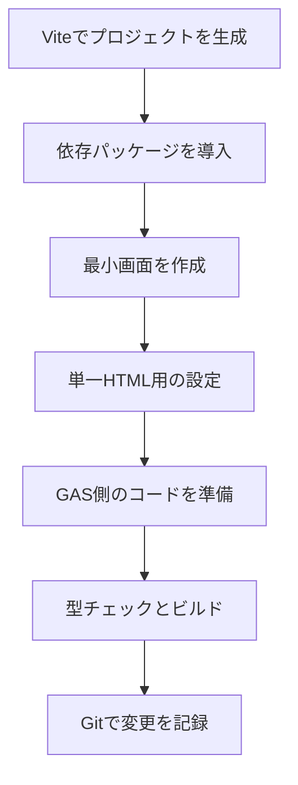
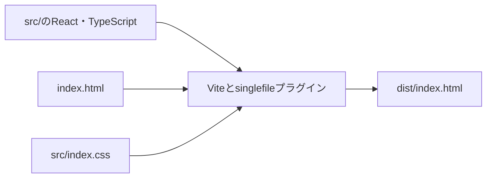

# 003. プロジェクトの作成

## この章の目的

React・TypeScript・Viteを使用して，GASアプリケーションの元になるプロジェクトを作成します。

この章では，次の内容を扱います。

- React・TypeScriptプロジェクトの初期化
- 最小画面の作成
- vite-plugin-singlefileの設定
- GAS側のソースコードの準備
- 型チェックとビルドの確認
- Gitによる変更管理

GASプロジェクトへの接続とデプロイは，第5章で行います。

## 1. 前提条件

前の章で，次のコマンドを使用できる状態にしておきます。

```sh
node --version
npm --version
git --version
clasp --version
```

使用するNode.jsは，導入するViteと各パッケージの動作要件を満たすものを選んでください。

### 1.1 作業ディレクトリの考え方

この章では，読者自身のアプリケーションを，ドキュメントのリポジトリとは別のディレクトリに作成します。

例として，次の配置を使用します。

```text
~/git/
├── gas-react-guide/   # この手順書のリポジトリ
└── gas-react-app/     # この章で作成するアプリ
```

既存のGitリポジトリの内側に，意図せず別のリポジトリを作らないように注意してください。

以降，特に指定がなければ，コマンドはアプリケーションのルートで実行します。

## 2. 作業の流れ



基本編では，まず単一画面のアプリケーションを作成します。

Tailwind CSS，React Router，Googleサービスとの通信は，応用編で追加します。

## 3. React・TypeScriptプロジェクトを作成する

### 3.1 プロジェクトを生成する

作成先の親ディレクトリへ移動します。

```sh
mkdir -p ~/git
cd ~/git
```

同名の `gas-react-app` が既にある場合は，別名を使用してください。既存ディレクトリへ無条件に上書きしないでください。

ViteのReact・TypeScriptテンプレートで生成します。

```sh
npm create vite@latest gas-react-app -- --template react-ts
```

追加の質問が表示された場合は，標準的なReact・TypeScript構成を選択します。

パッケージの自動インストール・開発サーバー起動を尋ねられた場合は，この手順では行わず，次のコマンドで明示的に実行します。

```sh
cd ~/git/gas-react-app
npm install
```

`@latest` は実行時点のバージョンを取得します。生成される補助ファイルや初期設定は，時期によって変わる場合があります。

### 3.2 追加パッケージを導入する

```sh
npm install --save-dev vite-plugin-singlefile
```

この章では，GASへ配置しやすいHTMLを生成するために使用します。

依存関係に関する警告やエラーが出た場合は，内容を確認してください。`--force` や `--legacy-peer-deps` を無条件に使用して回避しないでください。

## 4. プロジェクトの構成

この章で使用する主要なファイルは次のとおりです。

```text
gas-react-app/
├── gas/
│   ├── Code.js
│   └── appsscript.json
├── src/
│   ├── App.tsx
│   ├── index.css
│   └── main.tsx
├── .gitignore
├── index.html
├── package.json
├── package-lock.json
├── tsconfig.json
├── tsconfig.app.json
├── tsconfig.node.json
└── vite.config.ts
```

テンプレートには，このほかにリンターの設定やサンプル画像などが含まれる場合があります。

生成物とソースコードは分けて管理します。

| パス | 役割 | Git管理 |
|---|---|---|
| `src/` | フロントエンドのソース | 対象 |
| `gas/` | GAS側のソースとマニフェスト | 対象 |
| `dist/` | Viteが生成するHTMLなど | 原則として対象外 |
| `build/gas/` | 第5章で用意するGASへの反映対象 | 原則として対象外 |
| `node_modules/` | インストールした依存パッケージ | 対象外 |
| `package-lock.json` | 依存パッケージの解決結果 | 対象 |

`dist/` と `build/gas/` は同じものではありません。

第5章では，`dist/index.html` と `gas/` のファイルを `build/gas/` に集め，そのディレクトリをclaspの反映対象にします。

## 5. 最小画面を作成する

以下のファイルは，それぞれ内容全体を置き換えます。

### 5.1 src/App.tsx

```tsx
import { useState } from "react";

export default function App() {
  const [count, setCount] = useState(0);

  return (
    <main className="app">
      <section className="card">
        <p className="eyebrow">Google Apps Script</p>
        <h1>Reactで作るGASアプリ</h1>

        <p>
          ReactとTypeScriptで作成した画面です。
          ボタンを押して動作を確認してください。
        </p>

        <button
          type="button"
          onClick={() => setCount((previous) => previous + 1)}
        >
          カウントを増やす
        </button>

        <p role="status" aria-live="polite">
          現在のカウント：{count}
        </p>
      </section>
    </main>
  );
}
```

この段階ではGASの関数を呼び出しません。カウンターはブラウザ内の状態として管理し，再読み込みすると初期値へ戻ります。

### 5.2 src/main.tsx

```tsx
import { StrictMode } from "react";
import { createRoot } from "react-dom/client";
import App from "./App";
import "./index.css";

const rootElement = document.getElementById("root");

if (!rootElement) {
  throw new Error("画面の描画先が見つかりません。");
}

createRoot(rootElement).render(
  <StrictMode>
    <App />
  </StrictMode>,
);
```

### 5.3 src/index.css

```css
:root {
  font-family:
    system-ui, -apple-system, BlinkMacSystemFont, "Segoe UI",
    sans-serif;
  color: #1f2937;
  background: #f3f4f6;
  font-synthesis: none;
  text-rendering: optimizeLegibility;
}

* {
  box-sizing: border-box;
}

body {
  margin: 0;
  min-width: 320px;
}

.app {
  display: grid;
  min-height: 100vh;
  place-items: center;
  padding: 24px;
}

.card {
  width: 100%;
  max-width: 640px;
  padding: 32px;
  border: 1px solid #d1d5db;
  border-radius: 16px;
  background: #ffffff;
}

.eyebrow {
  color: #4b5563;
  font-size: 0.875rem;
}

h1 {
  margin-top: 0;
  font-size: clamp(1.5rem, 5vw, 2rem);
}

p {
  line-height: 1.8;
}

button {
  padding: 12px 20px;
  border: 0;
  border-radius: 8px;
  background: #1d4ed8;
  color: #ffffff;
  font: inherit;
  cursor: pointer;
}

button:hover {
  background: #1e40af;
}

button:focus-visible {
  outline: 3px solid #111827;
  outline-offset: 4px;
}
```

基本編では通常のCSSを使用します。Tailwind CSSへの変更は応用編で扱います。

### 5.4 index.html

```html
<!doctype html>
<html lang="ja">
  <head>
    <meta charset="UTF-8" />
    <meta
      name="viewport"
      content="width=device-width, initial-scale=1.0"
    />
    <title>Reactで作るGASアプリ</title>
  </head>
  <body>
    <div id="root"></div>
    <script type="module" src="/src/main.tsx"></script>
  </body>
</html>
```

テンプレートのアイコン参照は，このHTMLへの置き換えで外します。

未使用になった `src/App.css` やサンプル画像は，参照が残っていないことを確認してから削除できます。

## 6. 単一HTMLを生成する設定

`vite.config.ts` の内容全体を置き換えます。

```ts
import { defineConfig } from "vite";
import react from "@vitejs/plugin-react";
import { viteSingleFile } from "vite-plugin-singlefile";

export default defineConfig({
  plugins: [react(), viteSingleFile()],
  base: "./",
  publicDir: false,
});
```

### 6.1 設定の意味

| 設定 | 目的 |
|---|---|
| `react()` | Reactの開発・ビルド用プラグインを使用する |
| `viteSingleFile()` | JavaScript・CSSを生成HTMLへインライン化する |
| `base: "./"` | ビルド時の参照URLを相対パス基準にする |
| `publicDir: false` | publicディレクトリの自動コピーを無効にする |

この最小構成では，publicディレクトリのファイルを使用しません。

画像やフォントを追加する場合は，読み込み方法と出力先を確認してください。プラグインを追加しただけで，任意の外部リソースまですべて埋め込まれるとは限りません。

### 6.2 ソースと生成物の関係



`dist/` はビルドによって再生成されるため，直接編集しません。

修正は元のソースに対して行い，再ビルドします。

## 7. GAS側のファイルを作成する

アプリケーションのルートで，ディレクトリを作成します。

```sh
mkdir -p gas
```

### 7.1 gas/Code.js

次の内容で新規作成します。

```js
function doGet() {
  return HtmlService.createHtmlOutputFromFile("index")
    .setTitle("Reactで作るGASアプリ")
    .addMetaTag(
      "viewport",
      "width=device-width, initial-scale=1"
    );
}
```

`index` は，GAS側に配置する `index.html` を指します。

この段階では `gas/index.html` を手作業で作成しません。第5章で，ビルド済みHTMLとこのサーバーコードを同じ配置先に集めます。

HTMLサービスでは，viewportの指定をGAS側の `addMetaTag()` でも行います。

### 7.2 gas/appsscript.json

次の内容で新規作成します。

```json
{
  "timeZone": "Asia/Tokyo",
  "dependencies": {},
  "exceptionLogging": "STACKDRIVER",
  "runtimeVersion": "V8"
}
```

このファイルはGASのマニフェストです。

ここでは，タイムゾーン，例外ログ，実行環境に関する基本設定を記載します。

ウェブアプリの実行ユーザーとアクセス範囲は，第5章のデプロイ手順で確認します。

### 7.3 フロントエンドとGASの言語を区別する

本ドキュメントの基本構成では，次のように分けます。

- フロントエンド：TypeScript・TSXで記述し，Viteでビルドする。
- GAS側：JavaScriptで記述し，GASの実行環境で動かす。

`gas/Code.js` をNode.jsで実行することは想定していません。`HtmlService` はGAS側のAPIです。

GAS側もTypeScriptで記述する構成は，この最小構成には含めません。

## 8. npmスクリプトを確認する

`package.json` の既存設定を維持したまま，次のコマンドで必要なスクリプトを設定します。

```sh
npm pkg set 'scripts.dev=vite'
npm pkg set 'scripts.typecheck=tsc -b'
npm pkg set 'scripts.build=tsc -b && vite build'
npm pkg set 'scripts.preview=vite preview'
```

設定結果を確認します。

```sh
npm pkg get scripts
```

| コマンド | 目的 |
|---|---|
| `npm run dev` | 開発用サーバーを起動する |
| `npm run typecheck` | TypeScriptの型チェックを行う |
| `npm run build` | 型チェック後に本番用ビルドを行う |
| `npm run preview` | ビルド結果をローカルのHTTPサーバーで確認する |

`preview` はGASの実行環境を再現するものではありません。

## 9. 型チェックとビルドを確認する

```sh
npm run typecheck
npm run build
```

エラーなく終了したら，出力を確認します。

```sh
ls -lh dist/index.html
find dist -type f
```

この章の最小構成では，主な配信ファイルが `dist/index.html` にまとまることを確認します。

別のJavaScript・CSSや画像への参照が残っている場合は，GASで表示する前に参照先を確認してください。

ビルドが成功しても，GAS上での画面表示が確認できたことにはなりません。公開環境での確認は第5章で行います。

## 10. Gitの除外設定を追加する

テンプレートが生成した `.gitignore` を確認し，既存設定を残したまま，次の内容を追加します。

```gitignore
# Dependencies and generated files
node_modules/
dist/
build/
*.tsbuildinfo

# Local environment files
.env
.env.*
!.env.example

# clasp authentication and local connection settings
.clasprc.json
.clasprc.*.json
.clasp.json

# macOS
.DS_Store
```

この手順では，環境ごとに異なる `.clasp.json` をGit管理から除外します。

`.clasp.json` に記載するスクリプトID自体を認証トークンと同一視するものではありません。読者ごとの接続先を共有設定へ混在させないための方針です。

設定例が必要な場合は，実際のIDを含まない `.clasp.json.example` を用意します。具体的な設定は第5章で説明します。

なお，`.env` を除外するだけで，ビルド結果への秘密情報の混入を防げるわけではありません。ブラウザへ配信するコードに秘密情報を渡さないでください。

## 11. Gitで変更を記録する

### 11.1 リポジトリを確認する

```sh
git rev-parse --show-toplevel
```

Gitリポジトリではないというエラーが出る場合は，アプリケーションのルートで初期化します。

```sh
git init
```

親ディレクトリのリポジトリが表示された場合は，そのまま続けず，作成場所を確認してください。

### 11.2 追加対象を確認する

```sh
git status --short
git add --dry-run .
```

次のファイルが追加対象になっていないことを確認します。

- `node_modules/` 以下
- `dist/` 以下
- `build/` 以下
- 認証情報
- 実際の秘密情報を含む環境設定

`package.json` と `package-lock.json` は管理対象に含めます。

### 11.3 コミットする

```sh
git add .
git diff --cached --stat
git diff --cached
git commit -m 'GASアプリの初期構成を作成'
```

差分に想定外のファイルが含まれている場合は，コミットする前に修正します。

## 12. この章の確認

- [ ] アプリケーションを作成するディレクトリを確認した。
- [ ] React・TypeScriptのプロジェクトを作成した。
- [ ] 依存パッケージをインストールした。
- [ ] 最小画面へ置き換えた。
- [ ] vite-plugin-singlefileを設定した。
- [ ] `gas/Code.js` を作成した。
- [ ] `gas/appsscript.json` を作成した。
- [ ] `npm run typecheck` が成功した。
- [ ] `npm run build` が成功した。
- [ ] `dist/index.html` が生成された。
- [ ] Gitの除外設定を確認した。
- [ ] 変更内容を確認してコミットした。

次の章では，開発用サーバーを起動し，画面の動作確認とブラウザでのデバッグを行います。

## 参考資料

- [Viteの導入ガイド](https://ja.vite.dev/guide/)
- [vite-plugin-singlefile](https://github.com/richardtallent/vite-plugin-singlefile)
- [HTMLサービスの概要](https://developers.google.com/apps-script/guides/html)
- [HtmlOutput](https://developers.google.com/apps-script/reference/html/html-output)
- [GASのマニフェスト](https://developers.google.com/apps-script/concepts/manifests)

---

[前の章：開発環境の準備](002-setup.md) | [目次へ戻る](../../README.md) | [次の章：ローカルでの実行とデバッグ](004-local-debug.md)
