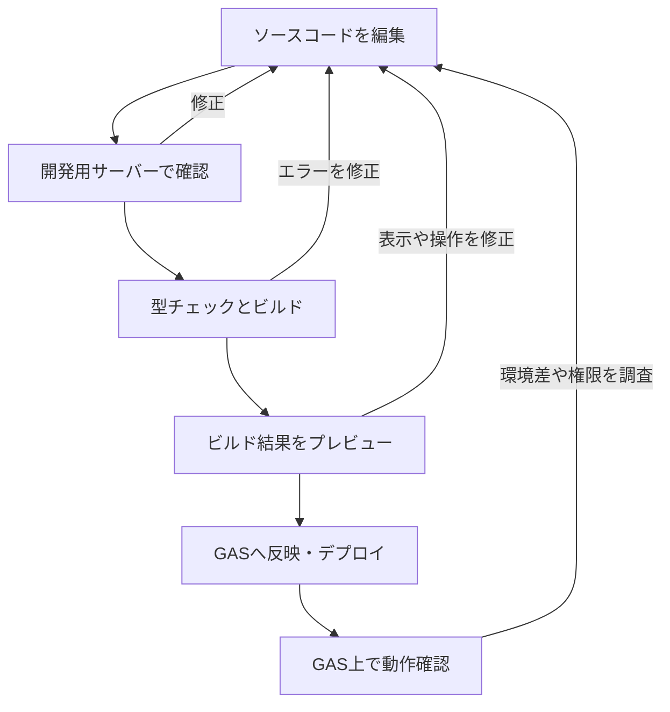
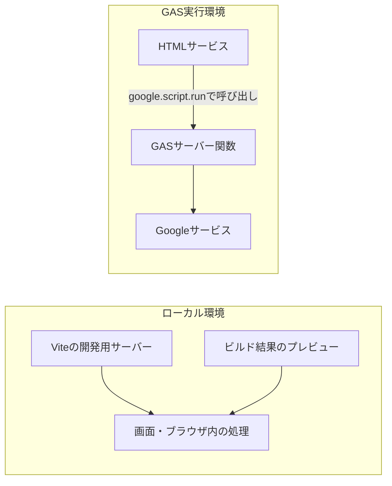

# 004. ローカルでの実行とデバッグ

## この章の目的

前の章で作成したアプリケーションをローカルで起動し，画面の動作を確認します。

この章では，次の内容を扱います。

- 開発用サーバーの起動と終了
- 表示と操作の確認
- ソースコードの変更と反映
- ブラウザの開発者ツールによる調査
- 型チェックと本番用ビルドの確認
- ローカルで確認できる範囲と，GAS上で確認する範囲

本文中のコマンドは，特に指定がなければアプリケーションのルートで実行します。

```sh
cd ~/git/gas-react-app
```

ドキュメントのリポジトリではなく，前の章で作成したアプリケーションのディレクトリであることを確認してください。

## 1. 確認方法の全体像

画面の確認を，次の3段階に分けます。



| 確認方法 | 主な目的 | この章での扱い |
|---|---|---|
| 開発用サーバー | ソースを編集しながら画面を確認する | 実施する |
| ビルド結果のプレビュー | 配信用ファイルの表示と操作を確認する | 実施する |
| GAS上での確認 | HTMLサービス，権限，サーバー処理などを確認する | 第5章以降で実施する |

ローカルで動いたことと，GAS上で動いたことは区別します。

## 2. 開発用サーバーを起動する

### 2.1 作業場所を確認する

```sh
pwd
npm pkg get scripts
```

`package.json` に，前の章で設定した `dev`，`typecheck`，`build`，`preview` があることを確認します。

### 2.2 サーバーを起動する

```sh
npm run dev
```

ターミナルに表示されたURLをブラウザで開きます。

標準的な初期設定では，次のURLが使用されます。

```text
http://localhost:5173/
```

ただし，ポートの使用状況や設定によってURLが変わる場合があります。実際に表示されたURLを使用してください。

サーバー起動中は，そのターミナルを開いたままにします。別のコマンドを実行する場合は，別のタブまたはウィンドウを使用します。

### 2.3 接続先とポートを固定する場合

確認用のURLを固定したい場合は，次のように起動します。

```sh
npm run dev -- --host 127.0.0.1 --port 5173 --strictPort
```

この場合の接続先は次のとおりです。

```text
http://127.0.0.1:5173/
```

`--strictPort` を付けると，指定ポートが使用中の場合に別のポートへ切り替えず，エラーで終了します。

`localhost` と `127.0.0.1` はブラウザでは異なるオリジンです。ストレージなどを確認する際は，同じ接続先を使い続けてください。

この手順では，外部端末から接続するための公開設定は行いません。必要がない限り，`--host 0.0.0.0` などで接続範囲を広げないでください。

## 3. 最小画面の動作を確認する

前の章で作成した画面について，次を確認します。

1. 「Reactで作るGASアプリ」という見出しが表示される。
2. 背景色やカード，ボタンのスタイルが適用される。
3. 初期カウントが `0` になっている。
4. ボタンを押すとカウントが増える。
5. ブラウザを再読み込みするとカウントが `0` に戻る。

このカウントはReactの状態として保持しているだけで，GASやスプレッドシートへ保存していません。再読み込みで初期値に戻るのは，このサンプルの想定動作です。

### 3.1 キーボード操作を確認する

マウスを使わず，次の操作も確認します。

1. Tabキーでボタンへ移動する。
2. フォーカスの位置が見えることを確認する。
3. EnterキーまたはSpaceキーでボタンを操作する。
4. カウントが増えることを確認する。

### 3.2 画面幅を変えて確認する

ブラウザの幅を狭くして，次を確認します。

- 文字やボタンが重ならない。
- カードが画面から大きくはみ出さない。
- 意図しない横スクロールが発生しない。
- ボタンや文字が読める大きさを保っている。

このサンプルには最小幅の設定があるため，すべての任意の幅に対応することを意味するものではありません。

## 4. ソースコードの変更を確認する

`src/App.tsx` の見出しを，一時的に変更します。

変更前：

```tsx
<h1>Reactで作るGASアプリ</h1>
```

変更後：

```tsx
<h1>ローカル開発の動作確認</h1>
```

保存後，ブラウザの表示に反映されることを確認します。

確認が終わったら，必要に応じて元の文言へ戻します。

Viteでは，変更内容に応じて更新の反映やページの再読み込みが行われます。編集内容によって状態が維持される場合と初期化される場合があるため，初期状態の検証では明示的に再読み込みしてください。

## 5. 開発者ツールを開く

この章では，Google Chromeの開発者ツールを例に説明します。

macOSでは，次のキーで開けます。

```text
Command + Option + I
```

メニューの名称や表示位置は，ブラウザのバージョンや表示言語によって異なる場合があります。

| パネル | 主な確認内容 |
|---|---|
| Elements | DOM，適用されているCSS，レイアウト |
| Console | 実行時エラー，警告，調査用のログ |
| Sources | ソースコード，ブレークポイント，変数 |
| Network | ファイルの取得状況，HTTPリクエストの結果 |

## 6. Consoleでエラーを確認する

Consoleを開いた状態で，ページを再読み込みし，ボタンを操作します。

赤いエラーが表示された場合は，次を確認します。

- 最初に表示されたエラーメッセージ
- エラーが発生したファイルと行番号
- 発生する操作
- 毎回発生するかどうか

複数のエラーが連続する場合は，最初のエラーから調べます。後続のエラーは，最初の問題の影響で発生している可能性があります。

### 6.1 一時的なログを追加する

イベント処理を確認したい場合は，一時的にログを追加できます。

```tsx
<button
  type="button"
  onClick={() => {
    console.log("カウントボタンを操作しました");
    setCount((previous) => previous + 1);
  }}
>
  カウントを増やす
</button>
```

ボタンを押し，Consoleにログが出ることを確認します。

調査が終わったら，不要なログは削除します。個人情報，トークン，業務上の機密情報をログへ出力しないでください。

フロントエンドの `console.log()` はブラウザ側のログです。GAS側の実行ログとは別です。

## 7. ブレークポイントで処理を止める

ログだけでは分かりにくい場合は，ブレークポイントを使用します。

1. Sourcesを開く。
2. ファイル名検索などで `App.tsx` を探す。
3. ボタンのイベント処理内にブレークポイントを設定する。
4. ボタンを押す。
5. 処理が停止した位置と，変数や呼び出し元を確認する。
6. 実行を再開する。
7. 確認後，ブレークポイントを解除する。

ソースの表示方法は，ブラウザやViteのバージョンによって変わる場合があります。

処理が停止したままの場合，画面操作が反応しないように見えることがあります。デバッガーで停止中ではないかも確認してください。

## 8. ElementsとNetworkで確認する

### 8.1 スタイルが適用されない場合

Elementsで対象要素を選択し，次を確認します。

- 想定したクラス名が付いているか。
- CSSの指定が存在するか。
- 別のCSSによって上書きされていないか。
- 要素の幅，高さ，余白が想定どおりか。

このサンプルでは，`src/main.tsx` の次の読み込みも確認します。

```tsx
import "./index.css";
```

### 8.2 ファイルを取得できない場合

Networkを開いて再読み込みし，失敗しているリクエストを確認します。

- ステータスコード
- リクエスト先URL
- 存在しない画像やCSSへの参照
- 想定外の外部通信

開発時には，Viteのモジュール配信や更新用の通信も表示されます。開発時のリクエスト数と，本番用ビルドのリクエスト数が同じになるとは限りません。

## 9. 型チェックを行う

開発用サーバーとは別のターミナルで実行します。

```sh
cd ~/git/gas-react-app
npm run typecheck
```

Viteによる画面表示の確認と，TypeScriptの型チェックは別です。画面が表示できても，型の整合性に問題が残っている場合があります。

エラーがある場合は，表示されたファイル名と行番号から修正します。

`as any` や型チェックの無効化で無条件に回避せず，型と実際のデータの関係を確認してください。

型チェックが成功しても，画面操作やGAS上の実行が保証されるわけではありません。

## 10. 本番用ビルドを確認する

### 10.1 ビルドする

```sh
npm run build
```

前の章では，型チェック後にViteのビルドを行うスクリプトを設定しています。

正常終了したら，出力を確認します。

```sh
ls -lh dist/index.html
find dist -type f
```

### 10.2 プレビューを起動する

```sh
npm run preview -- --host 127.0.0.1 --port 4173 --strictPort
```

次のURLを開きます。

```text
http://127.0.0.1:4173/
```

開発用サーバーと同様に，見た目，カウント操作，再読み込み，Consoleのエラーを確認します。

`vite preview` はローカル確認用のサーバーであり，本番運用には使用しません。

### 10.3 ソースを変更した場合は再ビルドする

プレビューは `dist/` の生成物を配信します。

ソースコードを変更しただけでは，プレビューの内容は更新されません。必要に応じてプレビューを停止し，次を実行します。

```sh
npm run build
npm run preview -- --host 127.0.0.1 --port 4173 --strictPort
```

`dist/index.html` を直接編集して問題を直すのではなく，元のソースや設定を修正してください。

## 11. ローカルとGASの違い



| 確認項目 | ローカル | GAS上 |
|---|---|---|
| Reactの画面表示 | 確認できる | 確認する |
| ブラウザ内の状態更新 | 確認できる | 確認する |
| ビルド済みHTMLの表示 | previewで確認できる | 確認する |
| `doGet()` の実行 | Viteでは実行しない | 確認する |
| `google.script.run` | 通常のローカルページには存在しない | HTMLサービスのページで確認する |
| GASからのGoogleサービス利用 | Viteでは実行しない | 権限と実データを含めて確認する |
| デプロイの実行ユーザー・アクセス範囲 | 確認できない | 確認する |

ローカルで `gas/Code.js` を保存しても，ViteがGASのサーバー関数を実行するわけではありません。

また，この手順ではローカルのブラウザからApps Script APIを直接呼ぶ構成や，GASの実行環境を再現するエミュレーターは用意しません。

### 11.1 モックを使用する方針

Googleサービスとの連携を追加する際は，画面から呼び出す処理を分離し，ローカルではモックを使用できる構成にします。

モックでは，次の状態を再現できるようにします。

- 正常にデータを取得できる。
- データが空である。
- 処理に時間がかかる。
- 処理に失敗する。

基本編のカウンターは通信を使用しないため，この章ではモックの実装を追加しません。

具体的な通信とモックの構成は，応用編の「104. Googleサービスとの連携」で扱います。

モックで成功しただけでは，実際のGoogleサービスへのアクセス権やGAS側の処理が正しいことは確認できません。

## 12. サーバーを終了する

サーバーを起動したターミナルで，次のキーを押します。

```text
Control + C
```

開発用サーバーとプレビューを別々に起動している場合は，それぞれ終了します。

ターミナルへプロンプトが戻ったことを確認してください。

## 13. よくある問題

### 13.1 package.jsonが見つからない

コマンドの実行場所を確認します。

```sh
pwd
ls
```

`package.json` のあるアプリケーションのルートへ移動してから再実行します。

### 13.2 ブラウザで接続できない

次を確認します。

- サーバーが起動中か。
- ターミナルにエラーが出ていないか。
- URLのホスト名とポートが正しいか。
- `http` と `https` を取り違えていないか。

この章の明示的な起動例はHTTPを使用します。

### 13.3 ポートが使用中と表示される

以前起動したサーバーが残っていないか確認します。

必要に応じて，使用しているプロセスを調べます。

```sh
lsof -nP -iTCP:5173 -sTCP:LISTEN
```

プレビューの場合はポートを変更します。

```sh
lsof -nP -iTCP:4173 -sTCP:LISTEN
```

停止する場合は，自分が起動したプロセスであることを確認し，元のターミナルでControl + Cを使用します。

確認せずにプロセスを強制終了しないでください。

### 13.4 画面が真っ白になる

Consoleの最初のエラーを確認します。

あわせて，次の点を確認します。

- `index.html` に `<div id="root"></div>` があるか。
- `src/main.tsx` のimportが正しいか。
- `App.tsx` の構文やexportに誤りがないか。
- Networkにファイル取得エラーがないか。

### 13.5 変更が反映されない

開発用サーバーとプレビューの，どちらを見ているかを確認します。

- 開発用サーバー：保存したソースの変更を確認する。
- プレビュー：再ビルドした生成物を確認する。
- GASの公開URL：反映とデプロイ更新後の内容を確認する。

別のプロジェクトで起動したサーバーや，古いタブを開いていないかも確認してください。

### 13.6 google is not definedと表示される

通常のローカルページで，GASのクライアントAPIを直接参照していないか確認します。

`google.script.run` を使用する処理と，ローカル確認用のモックを分離します。

単にブラウザを再読み込みしたり，Viteを再起動したりしても，GAS固有のAPIが追加されるわけではありません。

## 14. 変更内容を整理する

一時的に追加したログ，確認用の文言，調査用コードを見直します。

```sh
git status --short
git diff
```

変更を残す場合は，内容を確認してコミットします。

```sh
git add .
git diff --cached
git commit -m 'ローカルでの動作確認を反映'
```

変更がない場合は，コミットする必要はありません。

## 15. この章の確認

- [ ] アプリケーションのルートで作業した。
- [ ] 開発用サーバーを起動できた。
- [ ] 画面とスタイルを確認した。
- [ ] ボタンのカウント操作を確認した。
- [ ] 再読み込みで初期状態へ戻ることを確認した。
- [ ] キーボード操作と画面幅の変化を確認した。
- [ ] ソースの変更が反映されることを確認した。
- [ ] Consoleでエラーの有無を確認した。
- [ ] 型チェックが成功した。
- [ ] 本番用ビルドが成功した。
- [ ] ビルド結果をプレビューで確認した。
- [ ] ローカルでは確認できない項目を理解した。
- [ ] 不要なログや調査用コードを整理した。
- [ ] 使用したサーバーを終了した。

次の章では，ビルド済みHTMLとGAS側のファイルを配置用ディレクトリへまとめ，claspによる反映とウェブアプリのデプロイを行います。

## 参考資料

- [Viteの導入ガイド](https://ja.vite.dev/guide/)
- [Viteのコマンドラインインターフェース](https://ja.vite.dev/guide/cli)
- [Viteの静的サイトのデプロイとプレビュー](https://ja.vite.dev/guide/static-deploy)
- [Chrome DevTools](https://developer.chrome.com/docs/devtools/)
- [HTMLサービス：サーバー関数との通信](https://developers.google.com/apps-script/guides/html/communication)

---

[前の章：プロジェクトの作成](003-create-project.md) | [目次へ戻る](../../README.md) | [次の章：GASへのデプロイ](005-deploy.md)
