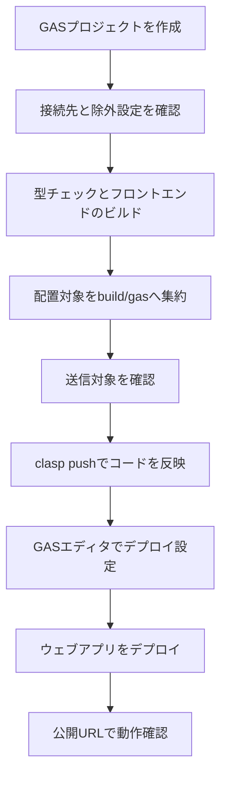
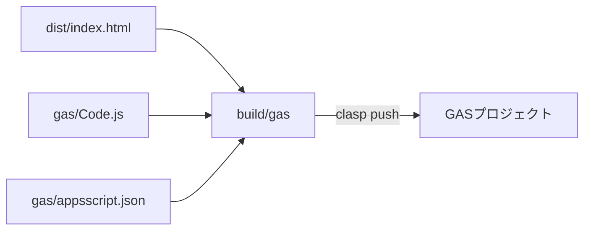
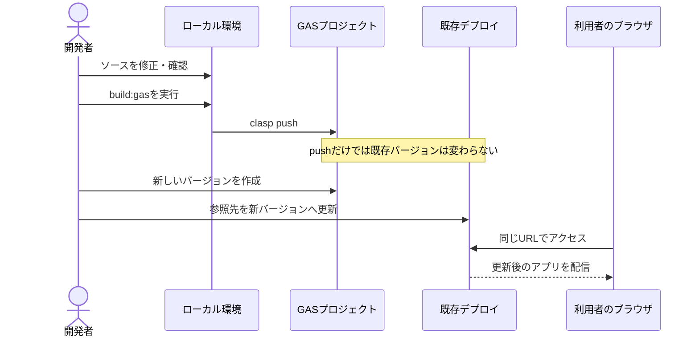

# 005. GASへのデプロイ

## この章の目的

ローカルで作成したアプリケーションを，GASのウェブアプリとしてデプロイします。

この章では，次の内容を扱います。

- GASプロジェクトの作成
- claspの接続設定
- GASへ配置するファイルの準備
- 送信対象の確認とコードの反映
- ウェブアプリの初回デプロイ
- 公開URLを維持した更新
- 公開後の確認と問題の切り分け

初回は，実行ユーザーとアクセス範囲を確認しやすいように，GASエディタからデプロイします。

本章で「公開」と呼ぶ操作は，ウェブアプリとして利用可能にすることを意味します。インターネット上の全員へアクセスを許可することを意味するものではありません。

## 1. 前提条件

前の章までに，次を完了しておきます。

- `clasp login` による認証
- Apps Script APIの有効化
- ローカルでの画面確認
- 型チェックとビルド
- `gas/Code.js` と `gas/appsscript.json` の作成
- Gitの除外設定

本文中のコマンドは，アプリケーションのルートで実行します。

```sh
cd ~/git/gas-react-app
```

### 1.1 claspのコマンドを確認する

```sh
clasp --version
clasp --help
```

本章では，次のコマンド名を使用します。

```sh
clasp create-script --help
clasp show-file-status --help
clasp open-script --help
```

古いバージョンでは，コマンド名やオプションが異なる場合があります。

本章の名前が見つからない場合は，公式ドキュメントとインストール済みバージョンを確認してください。無関係なコマンドで代用せず，使用するバージョンを揃えます。

## 2. デプロイまでの流れ



次の3つは別の操作です。

| 操作                 | 内容                                |
|----------------------|-------------------------------------|
| ビルド・配置準備     | GASへ送るファイルをローカルで作る   |
| コードの反映         | GASプロジェクト内のコードを更新する |
| デプロイの作成・更新 | 利用者が使うバージョンを指定する    |

`clasp push` が成功しても，既存のバージョン付きデプロイが自動的に新しいコードへ切り替わるわけではありません。

## 3. GASプロジェクトを作成する

### 3.1 既存設定の有無を確認する

```sh
ls -la .clasp.json
```

まだファイルがない場合に「存在しない」と表示されるのは正常です。

既に `.clasp.json` がある場合は，接続先を確認してください。既存の接続設定がある状態で，以下の新規作成を繰り返さないでください。

この章では，学習用の新規GASプロジェクトを使用します。既存の本番プロジェクトを接続先にしないでください。

### 3.2 新規作成する

`.clasp.json` がないことを確認してから実行します。

```sh
mkdir -p build/gas

clasp create-script \
  --type standalone \
  --title "Reactで作るGASアプリ" \
  --rootDir build/gas
```

このコマンドはGoogle側に新しいプロジェクトを作成します。確認のために何度も実行すると，別のプロジェクトが増えるため注意してください。

作成後，アプリケーションのルートにある `.clasp.json` を確認します。

```sh
cat .clasp.json
```

主要な設定は次の形になります。

```json
{
  "scriptId": "自分のGASプロジェクトのスクリプトID",
  "rootDir": "build/gas"
}
```

実際のスクリプトIDは，コマンドが生成した値を使用してください。

`rootDir` はGASへ反映するローカルディレクトリです。`src/` やリポジトリ全体を指定しないでください。

### 3.3 プロジェクトを開く

```sh
clasp open-script
```

開かれたGASエディタで，プロジェクト名とアカウントを確認します。

必要に応じて，GASエディタのプロジェクト設定にあるスクリプトIDと，`.clasp.json` の `scriptId` が一致することを確認します。

### 3.4 接続設定のサンプルを作る

共有用として，アプリケーションのルートに `.clasp.json.example` を作成します。

```json
{
  "scriptId": "YOUR_SCRIPT_ID",
  "rootDir": "build/gas"
}
```

実際の `.clasp.json` は環境ごとの設定としてGitから除外し，サンプルだけを管理する方針です。

プレースホルダーのままの設定では，GASへ接続できません。

## 4. claspの送信対象を制限する

アプリケーションのルートに `.claspignore` を作成します。

この基本構成では，次の3ファイルだけを送信対象にします。

```text
**/**
!appsscript.json
!Code.js
!index.html
```

`.claspignore` のパターンは，`.clasp.json` の `rootDir` を基準に適用されます。

この場合は，次のファイルが対象です。

```text
build/gas/
├── appsscript.json
├── Code.js
└── index.html
```

`.gitignore` と `.claspignore` は別の設定です。

| 設定           | 目的                               |
|----------------|------------------------------------|
| `.gitignore`   | Gitの管理対象から除外する          |
| `.claspignore` | claspでGASへ送信する対象を制限する |

ファイルを増やす場合は，配置準備と `.claspignore` の両方を更新し，送信対象を再確認します。

## 5. 配置準備用スクリプトを作成する

フロントエンドの生成物と，GAS側のソースを同じディレクトリへ集めます。



### 5.1 スクリプトを作成する

```sh
mkdir -p scripts
```

`scripts/prepare-gas.mjs` を次の内容で作成します。

```js
import {
  access,
  copyFile,
  mkdir,
  readdir,
  rm,
} from "node:fs/promises";
import { fileURLToPath } from "node:url";

const projectRoot = new URL("../", import.meta.url);
const outputDirectory = new URL("build/gas/", projectRoot);

const files = [
  ["dist/index.html", "index.html"],
  ["gas/Code.js", "Code.js"],
  ["gas/appsscript.json", "appsscript.json"],
];

const expectedNames = new Set(
  files.map(([, destination]) => destination),
);

try {
  for (const [source] of files) {
    await access(new URL(source, projectRoot));
  }

  await mkdir(outputDirectory, { recursive: true });

  const entries = await readdir(outputDirectory, {
    withFileTypes: true,
  });

  for (const entry of entries) {
    if (!expectedNames.has(entry.name) || !entry.isFile()) {
      throw new Error(
        `配置先に想定外の項目があります: ${entry.name}`,
      );
    }
  }

  // 想定外のファイルを誤送信しないよう，失敗時は送信しません。
  for (const entry of entries) {
    await rm(new URL(entry.name, outputDirectory));
  }

  for (const [source, destination] of files) {
    await copyFile(
      new URL(source, projectRoot),
      new URL(destination, outputDirectory),
    );
  }

  console.log(
    `GASへの配置対象を準備しました: ${
      fileURLToPath(outputDirectory)
    }`,
  );
} catch (error) {
  console.error("GASへの配置準備に失敗しました。");
  console.error(
    error instanceof Error ? error.message : error,
  );
  process.exitCode = 1;
}
```

このスクリプトは，入力ファイルの存在を確認してから配置先を更新します。

`build/gas/` に想定外のファイルやディレクトリがある場合は，自動削除せず停止します。中身を確認して，必要なものはソース側へ退避してください。

この構成では，`build/gas/` 内のファイルを直接編集しません。編集内容は次回の配置準備で置き換わります。

### 5.2 npmスクリプトを追加する

```sh
npm pkg set \
  'scripts.build:gas=npm run build && node scripts/prepare-gas.mjs'
```

確認します。

```sh
npm pkg get scripts
```

### 5.3 ビルドと配置準備を実行する

```sh
npm run build:gas
```

型チェック，フロントエンドのビルド，配置準備のいずれかが失敗した場合は，GASへ送信せず原因を修正します。

正常終了したら確認します。

```sh
find build/gas -type f
```

次の3ファイルがあることを確認します。

```text
build/gas/Code.js
build/gas/appsscript.json
build/gas/index.html
```

新規作成時に生成されたマニフェストは，この手順で `gas/appsscript.json` の内容に置き換えます。以後，マニフェストの正本は `gas/appsscript.json` とします。

## 6. GASへコードを反映する

### 6.1 送信対象を確認する

```sh
clasp show-file-status
```

送信対象が次の3ファイルだけであることを確認します。

- `Code.js`
- `appsscript.json`
- `index.html`

表示上のパス表記はclaspのバージョンによって異なる場合があります。

`.env`，認証情報，`node_modules/`，フロントエンドのソース全体などが送信対象に入っている場合は停止し，`rootDir` と `.claspignore` を確認します。

### 6.2 反映する

```sh
clasp push
```

マニフェストの上書き確認が表示された場合は，接続先と変更内容を確認してから承認します。

最初から `--force` を付けて確認を省略しないでください。

claspのpushは，送信対象を使ってリモートプロジェクトの内容を置き換えます。リモートにしか存在しないファイルが失われる可能性があるため，既存の業務用プロジェクトへ安易に実行しないでください。

### 6.3 GASエディタで確認する

```sh
clasp open-script
```

次を確認します。

- サーバー側の `Code` ファイルがある。
- `index.html` がある。
- `doGet()` が `index` を返している。
- マニフェストが想定どおりである。

`.js` ファイルは，GASエディタ側ではサーバースクリプトとして表示されます。ローカルと表示上の拡張子が異なる場合があります。

## 7. 初回デプロイを行う

### 7.1 新しいデプロイを作成する

GASエディタで，次の順に操作します。

1. 「デプロイ」を開く。
2. 「新しいデプロイ」を選ぶ。
3. デプロイの種類に「ウェブアプリ」を選ぶ。
4. 説明を入力する。
5. 実行ユーザーとアクセス範囲を確認する。
6. 「デプロイ」を実行する。

画面の文言や選択肢は，アカウントや組織の設定によって異なる場合があります。

### 7.2 学習用の最初の設定

最初は，自分だけで確認できる最小限の設定にします。

| 設定                   | この手順での方針                           |
|------------------------|--------------------------------------------|
| 実行ユーザー           | 自分                                       |
| アクセスできるユーザー | 自分のみ，または利用可能な最も限定的な範囲 |

自分だけに限定する選択肢が利用できない場合は，組織の設定を確認し，意図せず広い範囲へ公開しないでください。

Googleサービスを利用する機能を追加する際は，実行ユーザーの選択を改めて検討します。

- 自分として実行：デプロイしたユーザーの権限でサーバー処理を実行する。
- アクセスしたユーザーとして実行：アクセスした利用者の権限でサーバー処理を実行する。

この違いは，データへのアクセス権や認可の設計に影響します。

フロントエンド上でボタンを隠すだけでは，サーバー側のアクセス制御にはなりません。

### 7.3 承認画面が表示された場合

アカウントと要求される権限を確認します。

最小画面の配信と，将来追加するGoogleサービスへのアクセスでは，必要な承認が異なる場合があります。

未確認アプリなどの警告が表示された場合も，対象プロジェクトと要求権限を確認せずに進めないでください。組織の制限がある場合は，管理者へ確認します。

### 7.4 URLとデプロイIDを記録する

デプロイ完了後，ウェブアプリのURLとデプロイIDを記録します。

通常のウェブアプリURLは，末尾が `/exec` です。

```text
[https://script.google.com/macros/s/DEPLOYMENT_ID/exec](https://script.google.com/macros/s/DEPLOYMENT_ID/exec)
```

これは形式の例です。実際には画面に表示されたURLを使用します。

スクリプトIDとデプロイIDは異なります。

| 識別子       | 用途                      |
|--------------|---------------------------|
| スクリプトID | GASプロジェクトを識別する |
| デプロイID   | 特定のデプロイを識別する  |

## 8. デプロイ後の動作確認

公開URLを開き，次を確認します。

1. 想定したGoogleアカウントでアクセスしている。
2. Reactの画面が表示される。
3. スタイルが適用される。
4. ボタンを押すとカウントが増える。
5. 再読み込みするとカウントが初期値へ戻る。
6. Consoleにアプリ由来のエラーが出ていない。
7. 設定したアクセス範囲に問題がない。

GASの画面はiframe内で動作するため，開発者ツールで調査するときは，対象フレームやConsoleの実行コンテキストにも注意します。

最小アプリのカウントはブラウザ内だけの状態です。ボタンを押しても，GASのサーバー関数やスプレッドシートへ保存する処理は実行しません。

## 9. テスト用URLとの違い

GASには，開発中の確認に使用するテスト用のURLもあります。

| URL     | 用途                             | 実行するコード                     |
|---------|----------------------------------|------------------------------------|
| `/dev`  | 編集権限を持つユーザーの開発確認 | 最後に保存されたコード             |
| `/exec` | デプロイしたウェブアプリの利用   | 対象デプロイに設定されたバージョン |

テスト用URLは，GASエディタの「デプロイ」からテスト用デプロイの画面を開いて取得します。

`/dev` のURLは編集権限を持つユーザー向けです。利用者への通常の配布先には使用しません。

`/dev` では更新されているのに `/exec` では古いままの場合は，デプロイに指定されたバージョンを確認してください。

## 10. 同じURLのまま更新する

### 10.1 ソースを修正する

`src/` または `gas/` のソースを変更します。

GASエディタとローカルの両方で無秩序に編集しないでください。この手順では，ローカルのソースを正本とします。

### 10.2 ローカルで確認して反映する

```sh
npm run build:gas
clasp show-file-status
clasp push
```

各処理が成功したことを確認してから次へ進みます。

### 10.3 既存デプロイを更新する

GASエディタで，次の順に操作します。

1. 「デプロイ」から「デプロイを管理」を開く。
2. 更新したい既存デプロイを選ぶ。
3. 編集操作を選ぶ。
4. バージョンに「新バージョン」を選ぶ。
5. 変更内容が分かる説明を入力する。
6. デプロイを更新する。

既存デプロイが参照するバージョンを更新することで，同じURLを維持できます。

毎回「新しいデプロイ」を作成する必要はありません。



### 10.4 更新後に確認する

同じ `/exec` のURLを開き直し，変更が反映されていることを確認します。

更新履歴として，次を対応付けて記録すると調査しやすくなります。

- Gitのコミット
- GASのバージョン番号
- デプロイID
- 更新日時と変更内容

## 11. CLIから既存デプロイを更新する場合

初回設定後は，claspから既存デプロイを更新することもできます。

まず，対象を確認します。

```sh
clasp list-deployments
```

対象のデプロイIDを確認したうえで，次の形式で実行します。

```sh
clasp create-deployment \
  --deploymentId "YOUR_DEPLOYMENT_ID" \
  --description "画面の表示内容を更新"
```

`YOUR_DEPLOYMENT_ID` は，実際の対象に置き換えます。

この操作の前に，ビルドと `clasp push` を完了しておきます。

本章では，実行ユーザーとアクセス範囲を明示的に確認するため，初回デプロイはGASエディタで行う方針です。

## 12. 更新を戻す場合

問題が起きた場合は，「デプロイを管理」で既存デプロイを編集し，動作確認済みの以前のバージョンへ戻す方法があります。

その後，ローカルのコードも調査・修正し，次回の反映で同じ問題を再発させないようにします。

デプロイのバージョンを戻しても，スプレッドシートなどに対して実行済みのデータ変更は元に戻りません。

業務データを扱う段階では，コードの復旧とデータの復旧を別々に設計します。

## 13. よくある問題

### 13.1 indexというHTMLが見つからない

次を確認します。

- `npm run build:gas` が成功したか。
- `build/gas/index.html` があるか。
- `clasp show-file-status` にHTMLが含まれるか。
- 接続先のGASプロジェクトが正しいか。
- `clasp push` が成功したか。

### 13.2 更新したのに古い画面が出る

次の順で確認します。

1. 元のソースを修正したか。
2. `npm run build:gas` を実行したか。
3. `clasp push` が成功したか。
4. 既存デプロイを新しいバージョンへ更新したか。
5. 意図したデプロイのURLを開いているか。

キャッシュだけを原因と決めつけず，ビルドとデプロイの対応を確認します。

### 13.3 ローカルでは動くがGASでは動かない

次を確認します。

- 別ファイルのJavaScriptやCSSに依存していないか。
- 画像やフォントの参照先が取得できるか。
- GASのHTMLサービス上で使用できない処理がないか。
- Consoleに実行時エラーが出ていないか。
- GAS側で例外が発生していないか。

ローカルのプレビューは，GASの実行環境を再現するものではありません。

### 13.4 アクセスできないと表示される

次を確認します。

- 設定したアクセス範囲
- ブラウザで使用中のGoogleアカウント
- 組織の利用制限
- 対象URLが `/dev` か `/exec` か
- 対象デプロイが有効か

原因を確認せずに「全員へ公開」へ変更しないでください。

### 13.5 配置準備が想定外のファイルを検出する

`build/gas/` の内容を確認します。

```sh
ls -la build/gas
```

必要なファイルは `gas/` などのソース側へ移し，配置スクリプトと `.claspignore` を更新します。

意図しないファイルであることを確認するまでは削除しないでください。

### 13.6 GASエディタで編集した内容が消えた

`clasp push` はローカルの対象ファイルでリモートを置き換えます。

GASエディタで修正した場合は，その内容をローカルの正本へ取り込んでから次の反映を行ってください。

本構成で `clasp pull` を実行すると，取得先は `build/gas/` です。そのままでは次回の配置準備で置き換わるため，必要な変更を `gas/` などの正本へ反映する必要があります。

## 14. Gitへ変更を記録する

追加・変更した内容を確認します。

```sh
git status --short
git diff
git check-ignore .clasp.json
```

`.clasp.json` と生成物が除外され，次のファイルが管理対象になっていることを確認します。

- `.clasp.json.example`
- `.claspignore`
- `scripts/prepare-gas.mjs`
- `package.json`
- 必要に応じて変更したソースやマニフェスト

確認後，コミットします。

```sh
git add .
git diff --cached
git commit -m 'GASへの配置とデプロイ設定を追加'
```

公開するリポジトリに，認証情報や実データを含めないでください。

## 15. この章の確認

- [ ] 新規の学習用GASプロジェクトを作成した。
- [ ] スクリプトIDと接続先を確認した。
- [ ] `rootDir` を `build/gas` に設定した。
- [ ] `.claspignore` を設定した。
- [ ] 配置準備スクリプトを作成した。
- [ ] `npm run build:gas` が成功した。
- [ ] GASへ送る3ファイルを確認した。
- [ ] `clasp push` が成功した。
- [ ] GASエディタで反映結果を確認した。
- [ ] 実行ユーザーとアクセス範囲を確認した。
- [ ] ウェブアプリをデプロイした。
- [ ] `/exec` のURLで動作確認した。
- [ ] コードの反映とデプロイ更新の違いを理解した。
- [ ] 同じURLを維持した更新方法を確認した。
- [ ] ローカルの変更をGitへ記録した。

これで基本編は完了です。

応用編では，この最小構成をもとに，画面のスタイリング，コンポーネント設計，画面遷移，Googleサービスとの連携を追加します。

## 参考資料

- [claspの公式リポジトリ](https://github.com/google/clasp)
- [claspによるコマンドライン開発](https://developers.google.com/apps-script/guides/clasp?hl=ja)
- [GASのウェブアプリ](https://developers.google.com/apps-script/guides/web)
- [デプロイの作成と管理](https://developers.google.com/apps-script/concepts/deployments)

---

[前の章：ローカルでの実行とデバッグ](004-local-debug.md) | [目次へ戻る](../../README.md) | [次の章：Tailwind CSSによるスタイリング](../advanced/101-tailwindcss.md)
